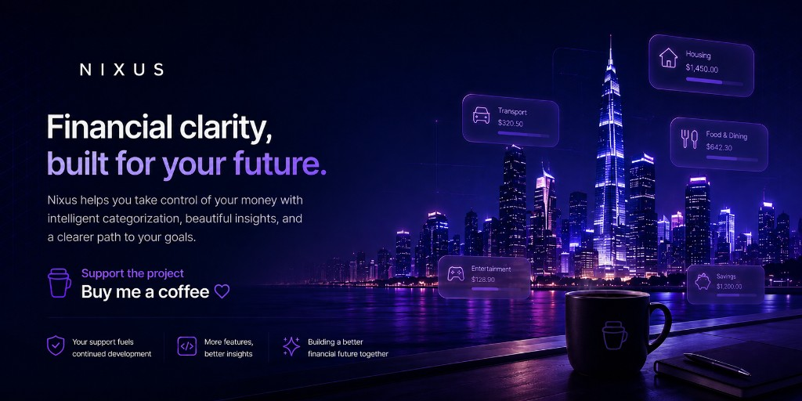
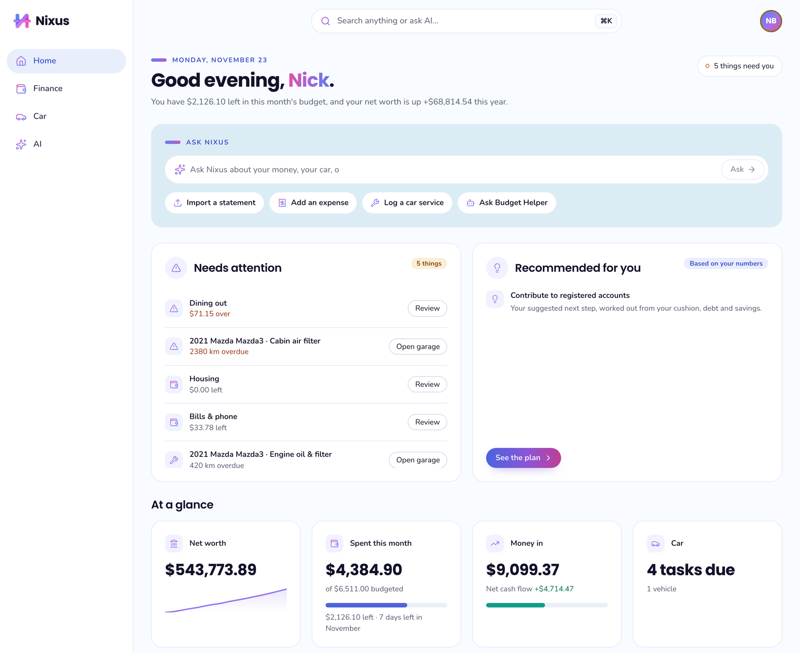
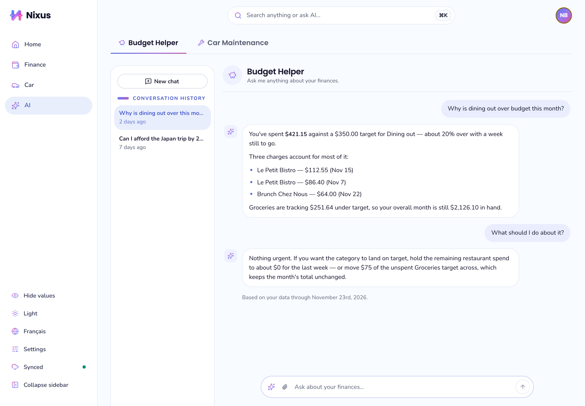
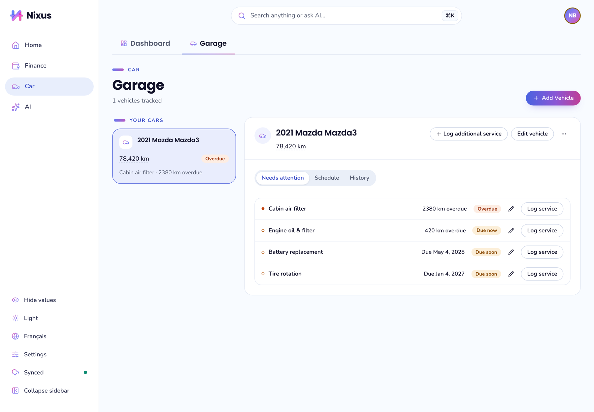

  

  

<strong>Personal finance and car upkeep, automated — with your records on your own computer.</strong>

  <a href="https://nixusapp.com">Website</a> ·
  <a href="https://nixusapp.com/download">Download</a> ·
  <a href="https://nixusapp.com/features">Features</a> ·
  <a href="https://nixusapp.com/pricing">Pricing</a> ·
  <a href="https://nixusapp.com/privacy">Privacy</a> ·
  <a href="CONTRIBUTING.md">Contributing</a>

---

Nixus is a **local-first desktop app** that takes the busywork out of tracking the things you should stay on top of. Drop in a credit card statement and it categorizes every transaction. Open the app and it tells you what to do next. Your data lives in a local SQLite database on your machine, with no bank logins and no account required.

It's built as a set of modules in one shared app. **Finance** and **Car** are available today.

> **Pre-alpha** — core features work, but things change and break between releases.

  

## Features

### Finance

- **Statement import** — upload a credit card PDF or screenshot; transactions are extracted and categorized, and you can correct any of them
- **Next actions** — a short, prioritized list of what to do, based on your own numbers
- **Budgets** — monthly category budgets with starter templates, recurring transactions, and income tracking
- **Accounts and assets** — banks, cards, investments, real estate and more, in CAD and USD
- **Registered accounts** — TFSA, RRSP and FHSA tracking, including contribution room
- **Net worth history** — assets and liabilities over time
- **Savings projects** — plan what you're saving for and fund it over time
- **Insights** — spending trends, a year-in-review, net worth projection, and a retirement planner
- **AI assistants** — ask questions about your money in plain language

### Car

- Garage for multiple vehicles
- Maintenance schedules, service history, and odometer tracking
- Due-date alerts and an AI assistant that answers from your service history

### Everywhere

- Multiple local profiles, each with its own separate data
- English and French
- Light, dark, and system themes
- Backup and restore, and automatic updates
- Optional [Nixus Cloud](https://nixusapp.com/pricing) account for multi-device sync and hosted AI

<table>
  <tr>
    <td width="50%" align="center">
      
       <em>AI budget assistant</em>
    </td>
    <td width="50%" align="center">
      
       <em>Car maintenance tracking</em>
    </td>
  </tr>
</table>

## Install

Download the latest release for **macOS** or **Windows** from [nixusapp.com/download](https://nixusapp.com/download) or the [GitHub releases](https://github.com/nickbazinet/nixus/releases/latest). Nixus is free to use on your computer and needs no account.

To build from source, see [CONTRIBUTING.md](CONTRIBUTING.md).

## Privacy

Your records stay on your machine. AI features and Nixus Cloud are optional and off until you use them, and the app works fully without either. Details are in the [privacy policy](https://nixusapp.com/privacy) and [terms](https://nixusapp.com/terms).

Nixus doesn't connect to your bank, and it's a tracking tool, not tax, legal, or investment advice.

## Tech stack

| | |
| --- | --- |
| **Desktop app** | Tauri 2, React 19, TypeScript, Rust, SQLite |
| **Website and account portal** | TanStack Start, React, Tailwind CSS |
| **Cloud services** | AWS (Lambda, DynamoDB, S3, Bedrock), Stripe for billing |
| **Repo** | pnpm monorepo: `apps/` (desktop, web, account, API services) and `packages/shared` (UI kit and design tokens) |

## Contributing

Contributions and bug reports are welcome. [CONTRIBUTING.md](CONTRIBUTING.md) covers setup, tests, and architecture; implementation rules live in [docs/project-context.md](docs/project-context.md).

## Feedback

Nixus is built by one person. If something confuses you or breaks, I want to hear about it: [open an issue](https://github.com/nickbazinet/nixus/issues) or [email me](mailto:support@nixus.nicolasbazinet.net). If you'd like to help test, see the [beta guide](https://nixusapp.com/beta).

  

