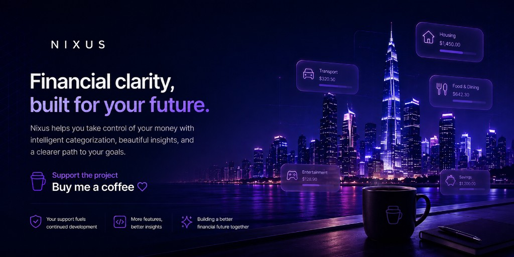
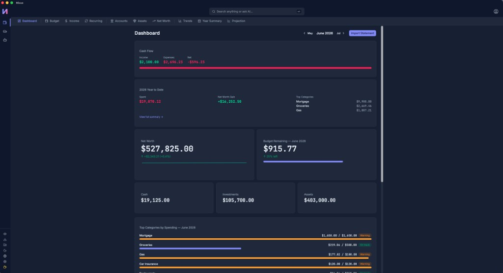
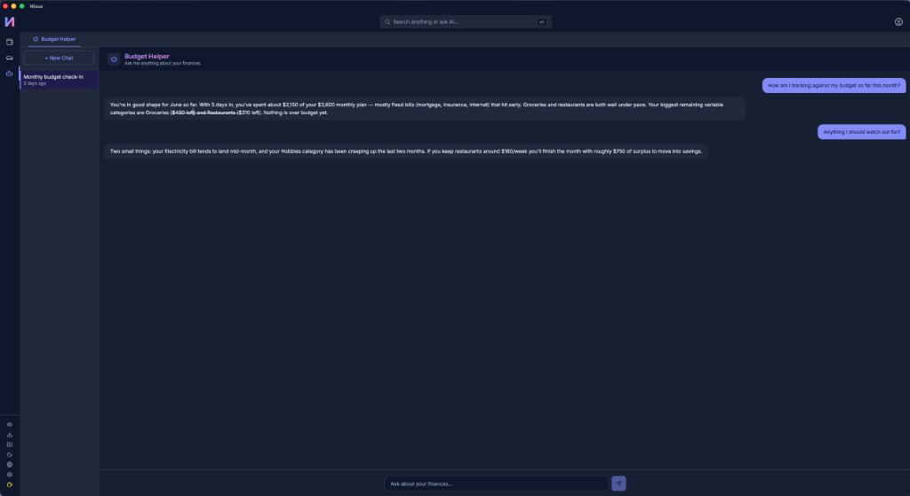
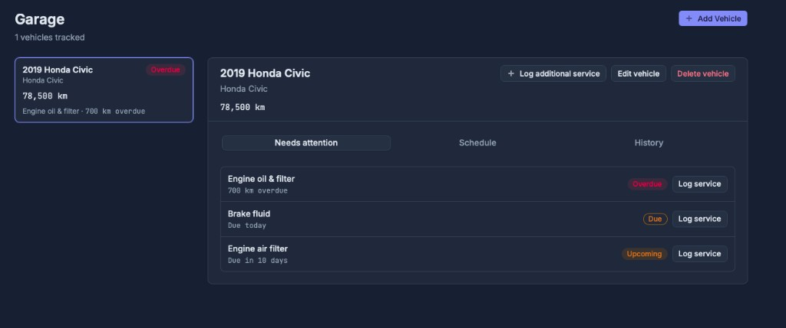

  

  

<strong>Automate and track your life — from one place, with your records on your own machine.</strong>

Nixus is a **local-first desktop app** for **lifestyle automation and tracking**. It uses technology to take the tedious upkeep out of the things you should be staying on top of — money, your car, and more over time — so you actually keep doing them. Each area of life is a module in one shared app, and your financial records are stored on your own machine. Two things can send them off it, and both are off until you turn them on: the optional AI features, which transmit the content of the one request you invoked, and optional sync across your own computers. See [AI features and your data](#ai-features-and-your-data) and [Sync across your computers (optional)](#sync-across-your-computers-optional).

**Finance** is the first module: upload a credit card statement, let AI categorize the transactions, and see your full picture — budget, accounts, assets, net worth — without touching a spreadsheet.

> **Pre-alpha** — core features work, but the product is still maturing. [See limitations](#what-nixus-is--and-isnt) before you download.

**[Download for macOS or Windows →](https://nixusapp.com)** · **[Beta testing](#help-shape-nixus)** · **[Contributing](CONTRIBUTING.md)**

  

---

## What is Nixus?

Most tracking tools die the moment they demand effort. Spreadsheets, maintenance logs, habit trackers — they all work until the upkeep becomes a chore and you quietly stop. **Nixus is built to remove that upkeep**, using automation and AI to handle the tedious parts (data entry, categorization, reminders) so staying organized doesn't depend on your willpower.

It's a **modular platform**: each area of your life is its own module in a shared shell (sidebar, consistent design, one install). **Finance** and **Car** are available today, and the shell is designed so new lifestyle modules can plug in over time.

Built by one person because my own spreadsheet stopped scaling. Not a startup pitch — a tool I use every week, opened to a small group of beta testers for honest feedback.

---

## Who it's for

- You still track personal finances in a **spreadsheet** (or gave up because it was too much work)
- You want **budget, expenses, accounts, and net worth** in one desktop app
- You prefer **local storage** over bank connections and always-on cloud services — with optional sync across your own computers if you want it
- You're okay uploading **credit card statements manually** (screenshot or PDF) instead of linking your bank
- You use **macOS or Windows**

## Who it's not for (yet)

- People who need **automatic bank sync** or Plaid-style connections
- **Mobile-first** users — desktop only, no mobile app (for now)
- **Multi-user / household** setups — one person's finances per install
- Anyone expecting **tax, legal, or investment advice** — this is a tracking tool (for now)
- People who need a **finished, stable product** — see [limitations](#what-nixus-is--and-isnt) below

---

## What's in the Finance module today

| Feature | What you get |
| ------- | ------------ |
| **AI statement import** | Upload a CC screenshot or PDF; transactions are extracted and categorized |
| **Budget builder** | Monthly budgets with category groups; see where you stand at a glance |
| **Expense tracking** | Review, correct, and manually add transactions; recurring templates |
| **Multi-account tracking** | Banks, credit cards, investment accounts (CAD and USD) in one view |
| **Passive assets** | Real estate, vehicles, business equity — the full picture |
| **Net worth history** | Track cash, TFSA, RRSP, crypto, housing, and more over time |
| **AI chat** | Ask questions about your data in natural language |
| **Income tracking** | Record monthly income alongside expenses for cash-flow visibility |

English and French UI · Light/dark/system theme · Auto-updates · Database backup/restore

---

## Modules

| Module | Status | What it covers |
| ------ | ------ | -------------- |
| **Finance** | Available | Budgeting, expenses, accounts, income, net worth, AI chat, CC import |
| **Car** | Available | Multi-vehicle garage, maintenance schedules, service history, odometer tracking, due-date alerts |

The app shell is designed so new modules plug in without reinventing the desktop experience each time.

---

## What Nixus is — and isn't

Before you download: an honest list so you know if this is worth your time.

- **No bank connection** — you upload credit card statements manually (screenshot or PDF).
- **Desktop only** — macOS and Windows. No mobile app.
- **Single user** — one person's finances per install.
- **AI features send that request's content off your machine** — either to your own AI provider using credentials you supply (stored in your OS keychain), or, for premium Nixus Cloud accounts, through Nixus infrastructure to AWS Bedrock in the United States. See [AI features and your data](#ai-features-and-your-data). The app works without AI; other features are unaffected.
- **Sync, if you turn it on, stores a copy of your records in Nixus-operated cloud storage** — it is off by default, needs a Nixus Cloud account that includes it, and is **not** end-to-end encrypted in this first version. See [Sync across your computers (optional)](#sync-across-your-computers-optional). Leave it off and no copy of your records leaves your machine.
- **Pre-alpha** — features change and things break between releases.
- **Not tax, legal, or investment advice** — a tracking tool, not a professional service.

More detail on the marketing site: [nixusapp.com/beta](https://nixusapp.com/beta)

---

## AI features and your data

Everything Nixus stores — budgets, transactions, accounts, assets, net worth history — lives in a local SQLite database on your machine. Nixus holds no copy of it unless you turn on [sync](#sync-across-your-computers-optional), which is off by default.

The AI features are the other exception, and they are opt-in by nature: they only run when you invoke them (statement import, AI chat, project advice, spending-trends insight). When you do, the content of that one request leaves your machine for processing:

- **Bring your own credentials (default).** The request goes directly from your machine to the provider you configured (AWS Bedrock or OpenAI) using credentials you supply. Nixus infrastructure is not involved and cannot see the request.
- **Nixus Cloud premium (hosted AI).** The request is transmitted **through Nixus's own infrastructure** to **AWS Bedrock**. Nixus does not store the prompt, the attached statement, the model's response, or the file name in its own databases or logs — it records only your account identifier, timestamps, request counts, and token counts for quota and billing purposes.

Two limits on that guarantee, stated plainly:

- **The non-retention guarantee covers Nixus-controlled systems only.** It does not bind AWS. AWS may process and, under Bedrock's terms and its abuse-detection policies, retain request content. Nixus does not control or override that.
- **Processing is cross-region within the United States.** Hosted AI uses a `us.` Bedrock cross-region inference profile, so a request may be processed in any US region AWS routes it to — which may be outside your country of residence — under AWS's terms for the handling region.

Hosted AI is subject to a **monthly request quota**. When it is unavailable, ineligible, or out of quota, Nixus falls back to your own configured provider where that provider supports the feature, and otherwise reports a normal error — the rest of the app is unaffected either way.

Full terms: [Privacy Policy](https://nixusapp.com/privacy) · [Terms of Service](https://nixusapp.com/terms)

---

## Sync across your computers (optional)

Nixus is local-only by default. If you want the same records on a second computer, you can turn on multi-device sync — it is off until you do, and it needs a Nixus Cloud account that includes multi-device sync. Leave it off and nothing in this section applies to you; a local-only profile runs no sync code at all.

**What it does.** Your changes travel continuously. Once your edits settle, Nixus uploads them as a log of changes, and periodically a full snapshot, covering budgets, transactions, accounts, income, assets, net worth history, vehicles, maintenance records, your in-app action history and your app settings. Signing in on a new computer downloads the latest snapshot plus everything after it, and your data is there. Full-size project images travel separately so they never slow that first load down: the snapshot carries only their thumbnails and a fingerprint, each full-size image is uploaded as its own object under that fingerprint, and a new computer downloads one the first time you ask to see it.

**How two computers are merged.** Field by field, with no question asked of you. When both computers changed the same field, the later change wins. When one deleted something another edited at the same time, the delete wins — and deleted items stay recoverable for 30 days, on every computer. Balances and counters are merged as additions, so two computers reacting to the same thing never double-count it. Edits you make offline are kept and sent when you are back online. Your action history travels as an append-only record and is never rewritten.

**What it is not.** It is not instant — changes move within seconds to a minute, not keystroke by keystroke. It is not a backup service. If one of your computers is running an older version of Nixus, it waits for the update before applying changes that version cannot read, and keeps working on your local data meanwhile. A computer that has not synced for more than 90 days re-downloads the latest snapshot and re-applies the changes it had not sent yet. The only time Nixus asks you to choose is the first time you link a computer that already has data of its own: load the cloud copy — your current local file is kept as a dated backup — or keep your local data and publish it over the cloud copy. Restoring a backup or copying a profile relinks that computer and asks the same question. **Deleting everything is account-wide:** on a profile that syncs, "Delete everything" also removes your records from your cloud sync and from your other computers — each of them empties itself the next time it checks in, with no prompt, because you already asked for it. Anything you entered on another computer *after* the deletion is kept. A computer whose data did not come from your cloud sync — a restored backup or a copied profile that has not linked yet — is never emptied this way; it asks the link question above instead.

**What is never uploaded.** Your AI provider credentials (they stay in your OS keychain), the settings describing this computer's AI provider configuration, Nixus's internal sync bookkeeping, and anything in a profile you keep local-only.

**Where it lives and who can read it.** A private storage bucket operated by Nixus on AWS in the US East (N. Virginia) region, with a separate location per account. Transfers use TLS; at rest the copy uses Amazon S3 server-side encryption (SSE-S3); each computer gets short-lived credentials scoped to that one account's location. Stated plainly: the copy is **not** end-to-end encrypted. Nixus does not read your records, but a Nixus administrator with access to that AWS account could technically do so, and so could AWS. The stored format reserves a marker for an encryption scheme so a future version can close that gap; it is not closed today.

**Retention and deletion.** Old change-log segments are deleted once a newer snapshot covers them, and previous versions of each object expire after 30 days. The current copy is kept for as long as sync is on, and it is kept — never deleted — if your account stops being eligible, in which case sync freezes: transfers stop and the local app keeps working normally. "Delete everything" in the app stops the cloud copy from ever being loaded again — by that computer, by your other computers, or by a new one you link afterwards — but it does **not** erase the stored objects, and most of them are not deleted at any later point either. The app is deliberately granted no permission to delete your data: its only delete permission is the cleanup inside your own location — superseded snapshots and change-log segments a newer snapshot covers — and it has none for the account binding, the pointers and roster your computers coordinate through, or your project images, so one computer cannot erase what the others are mid-download of. In practice the superseded snapshots are swept once newer ones replace them, while the change-log segments written before a "delete everything" and your uploaded pictures are not reclaimed at all. To have the stored bytes deleted outright, [email me](mailto:support@nixus.nicolasbazinet.net?subject=Nixus%20sync%20data%20deletion%20request) and ask; it is handled manually. Turning sync off stops transfers but does not delete the copy.

Sync is not a backup service — keeping your own backups is still your responsibility. Full detail: [Privacy Policy](https://nixusapp.com/privacy) · [Terms of Service](https://nixusapp.com/terms)

---

## Screenshots

  
   <em>Finance dashboard — budget, cash flow, and net worth at a glance</em>

<table>
  <tr>
    <td width="50%" align="center">
      
       <em>AI budget assistant</em>
    </td>
    <td width="50%" align="center">
      
       <em>Car maintenance tracking</em>
    </td>
  </tr>
</table>

More product visuals and an AI import demo: **[nixusapp.com](https://nixusapp.com)**. Additional screenshots live in [`docs/images/`](docs/images/).

---

## Help shape Nixus

I'm looking for a handful of people who still track personal finances in a spreadsheet and are willing to use Nixus for a few weeks and tell me what's confusing or broken. I built this for myself — I'm not asking you to promote it, just honest friction reports.

**[Email me about beta testing](mailto:support@nixus.nicolasbazinet.net?subject=Nixus%20beta%20tester%20interest)**

Or read the full beta guide on the site: [nixusapp.com/beta](https://nixusapp.com/beta)

---

## Tech at a glance

| | |
| --- | --- |
| **Stack** | Tauri 2, React 19, Rust, SQLite |
| **Platforms** | macOS, Windows |
| **Data** | Local SQLite on your machine; no account needed for your records ([AI features](#ai-features-and-your-data) and [optional sync](#sync-across-your-computers-optional) are the two exceptions) |
| **Repo** | pnpm monorepo: desktop app, marketing site, shared UI package |

Open source — inspect the code on GitHub. First-launch warnings (macOS Gatekeeper, Windows SmartScreen) are normal for apps not yet signed by Apple or trusted by Microsoft's reputation system.

---

## Links

| Resource | Description |
| -------- | ----------- |
| [nixusapp.com](https://nixusapp.com) | Download, features, FAQ, beta info |
| [Contributing](CONTRIBUTING.md) | Clone, run locally, tests, architecture |
| [Beta validation roadmap (June 2026)](docs/beta-validation-roadmap-june-2026.html) | How this pre-alpha is being validated |
| [Project context for AI agents](docs/project-context.md) | Implementation rules for contributors |

---

## Status

Nixus is in **pre-alpha**. The north star for June 2026: learn whether anyone besides the builder would actually use it — not growth, not revenue. If you try it, the most useful feedback is: *"What almost made you close it in the first 10 minutes?"*
