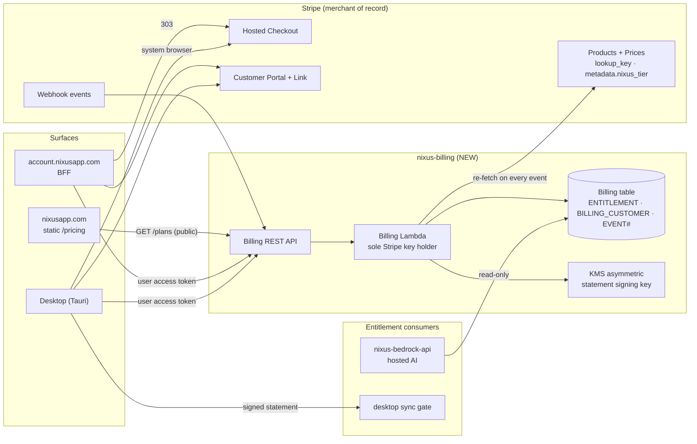
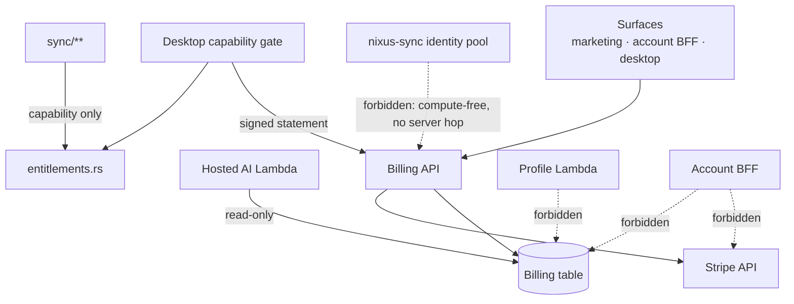
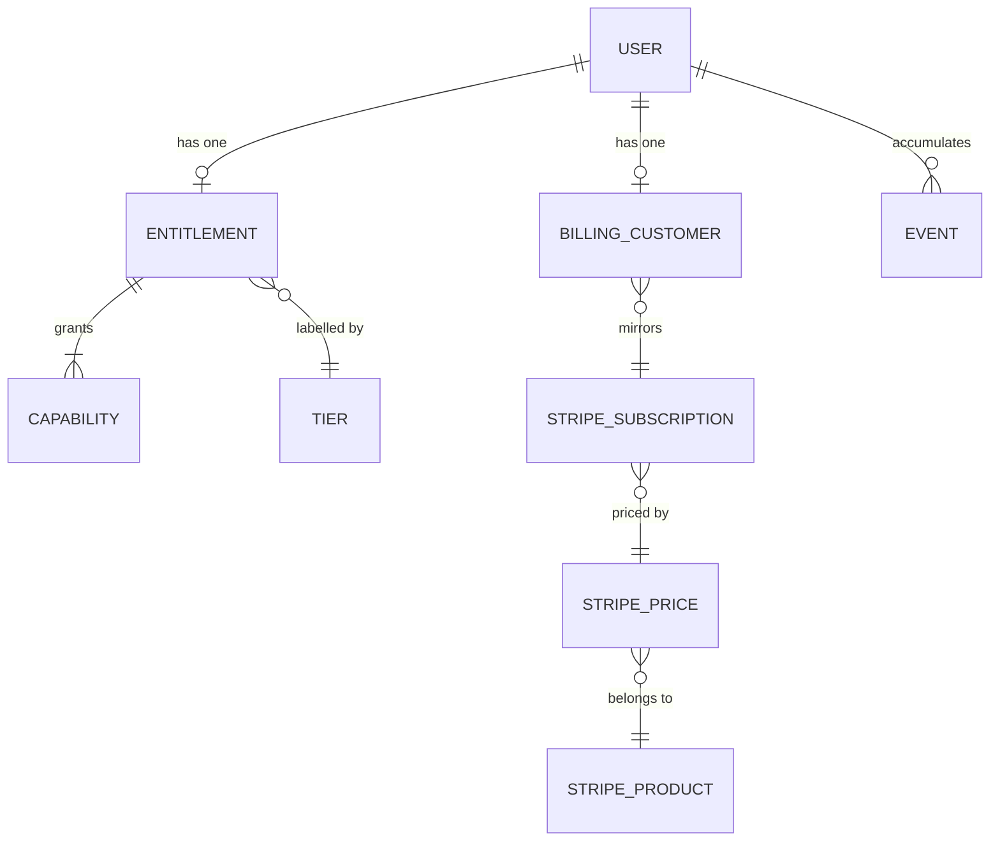
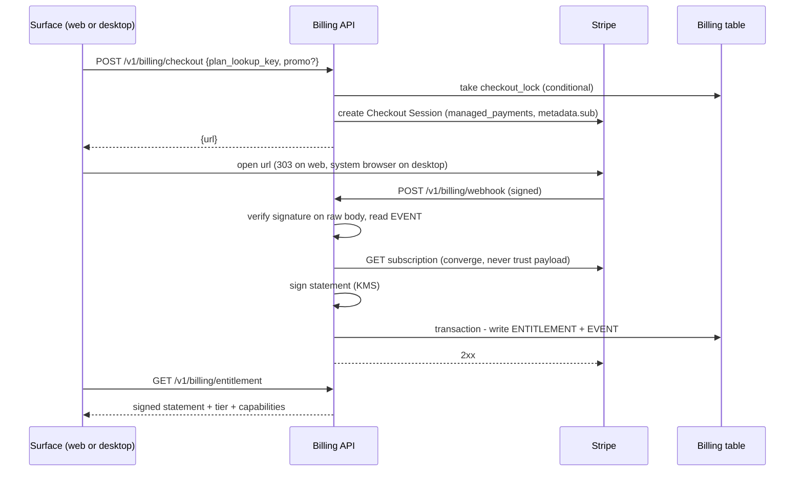
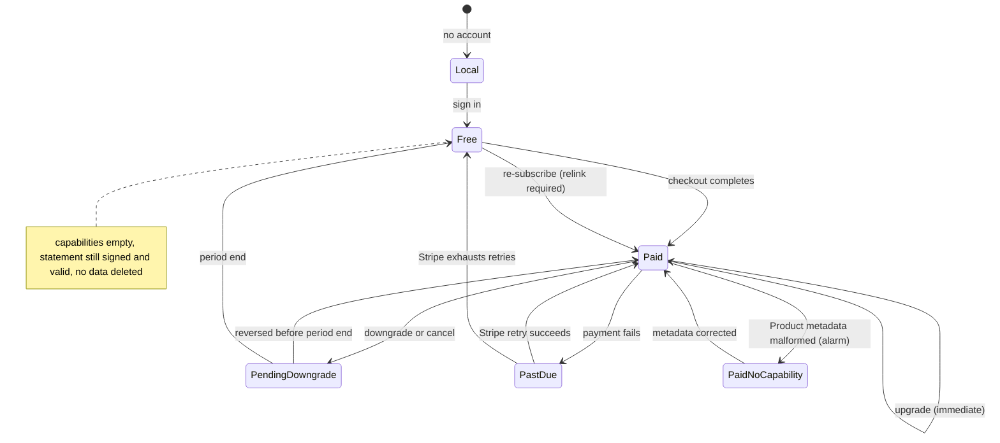

# Architecture Spine — Nixus Cloud Billing & Entitlements

**Capabilities governed:** CAP-1 entitlement authority · CAP-2 checkout · CAP-3 subscription self-management · CAP-4 signed statement & device gating · CAP-5 server-side gating · CAP-6 price catalog & pricing surfaces · CAP-7 discount and price operability · CAP-8 operations, cutover & release gates.

## Design Paradigm

**Webhook-converged entitlement authority with signed capability statements and Stripe-hosted commerce surfaces.**

- **Stripe owns commerce.** It is merchant of record, the product and price catalog, the checkout UI, the portal UI, the tax engine and the dunning schedule. Nixus stores no card data and builds no payment UI.
- **The billing service owns entitlement.** One stack (`nixus-billing`) is the only writer of entitlement state and the only holder of Stripe credentials. It converges on Stripe rather than accumulating deltas.
- **Consumers read capabilities, never tiers.** Hosted AI and sync ask "does this account grant capability X". A tier is a label for humans — the pricing page and support — and never appears in a gate.
- **Device-run capabilities gate on a signed statement.** The authority emits a short-lived, `sub`-bound, signed statement; the desktop verifies it offline against an embedded public key and fails closed.



Dependencies point one way: surfaces → billing API → billing table → Stripe. Nothing depends on a surface, and no surface depends on the billing table.

## Inherited Invariants

Parent ids are never renumbered. Inherited ADs are cited as `profile AD-n` (from `architecture-cloud-profile-billing-2026-11-17`) or `sync AD-n` (from `architecture-multi-device-sync-2026-10-13`) to keep them distinct from this spine's local `AD-n`.

| Inherited | From parent | Binds here |
| --- | --- | --- |
| Cognito user pool + stable `sub` is the sole identity authority | `architecture-login.md` | Entitlement key is `sub`; no second identity system |
| profile AD-3 — own stack, shared domain by `ApiMapping`, identity from verified claims only, UUID-shaped `sub` before any key exists | profile spine | AD-3, AD-4 |
| profile AD-4 — on-demand table, `pk = USER#<sub>`, server-owned `version`, conditional writes, `version_conflict` with `current_version` | profile spine | AD-4 — **declared departure:** the reserved `ENTITLEMENT`/`BILLING_CUSTOMER` sort keys move to a separate table |
| profile AD-9 — one token accessor that only *verifies* scope; requests always ask for the full scope set; a stored session is never replaced by a narrower one | profile spine | AD-17's scope rollout |
| profile AD-10 — account app is a BFF; one opaque `__Host-` session cookie, tokens server-side only, `Origin`-verified non-GET state changes, server-side destination allow-list | profile spine | AD-7, AD-8 |
| profile AD-11 — one writer and one validator per entity; CI guards both directions | profile spine | AD-2, AD-7 |
| profile AD-12 — no personal data or credentials in logs, errors or audit rows; no `audit_log` row for these mutations | profile spine | AD-14 |
| profile AD-13 — snake_case wire contract, closed error union, `GatewayResponses` emit the envelope, additive-only evolution, Rust mirror with contract tests | profile spine | AD-12, AD-13 |
| profile AD-14 — GitHub OIDC deploys, no long-lived keys, protected `production`, explicit log groups with 14-day retention, exact IAM action lists | profile spine | AD-15 |
| profile AD-15 — `api.nixusapp.com` domain owned by `nixus-bedrock-api`; other stacks attach by mapping only | profile spine | AD-3 |
| profile AD-17 — cloud-run premium gates server-side; device-run premium gates only on a server-signed, `sub`-bound, expiring statement verified offline with an embedded public key; no new premium capability ships with a client-side gate | profile spine | AD-9, AD-10 — **AD-9 is what satisfies it for sync** |
| profile D5 / D11 — profile-family query keys are *removed* (not invalidated) on identity change, by prefix sweep | profile spine | AD-11's cache rule, which must not mistake a cleared cache for a lapse |
| sync AD-7 — identity-pool credentials in the enhanced flow, scoped to `acct/<identity-id>/*`, identity pinned, **no request path through a server** | sync spine | AD-10 — constrains how sync can be gated at all |
| sync AD-14 — entitlement is one capability flag checked before every network operation; an absent capability is the Frozen state and leaves the local app fully working; the tier↔capability mapping lives in `entitlements.rs` and never in `sync/**` | sync spine | AD-1, AD-10, AD-11 — **declared departure:** AD-11 makes re-entitlement a relink rather than a plain resume |
| sync AD-17 — sync infrastructure is a separate, **compute-free** stack | sync spine | AD-10 — forbids a credential-broker Lambda in the sync path |
| sync AD-18 — cost and abuse are bounded client-side; the stack alarms but never stops traffic | sync spine | AD-10's residual-risk reasoning |
| Hosted AI falls back to a user's own provider when hosted is ineligible; BYO credentials take precedence on every AI surface | `architecture-cloud-bedrock.md`, `ai/home_surface.rs` | AD-12 |

## Invariants & Rules



### AD-1 — Capabilities are the only gate; a tier is a label; one projection home [ADOPTED]

- **Binds:** CAP-1, CAP-4, CAP-5, all consumers
- **Prevents:** A new tier requiring edits across feature code; two surfaces disagreeing on what a tier includes; a paid tier hard-coded into a feature; the tier→capability table being rebuilt in a second place.
- **Rule:**
  - A gate may test only a **capability**. No code in any language or surface may branch on `tier` — not `sync/**`, not hosted AI, not the UI, not an authorizer. A CI guard asserts that no file outside the capability-name parser compares a tier value.
  - `tier` is carried on the entitlement and the statement for exactly two consumers: user-facing display, and operations (support must see who is owed faster support). Neither is a gate.
  - The capability set is a **closed compile-time union** in `packages/shared/src/types/billing.ts`, mirrored in `entitlements.rs`, with a parity test. Launch set: `multi_device_sync`, `hosted_ai`, `household_net_worth`.
  - **One projection, three roles — no tier table outside the authority.** Stripe Product metadata is the *source*; the validated `capabilities[]` array on the `ENTITLEMENT` record is the *canonical projection*; `entitlements.rs` only parses received capability names into its `Capability` constants and holds **no tier→capability table at all**. `PREMIUM_CLOUD_CAPABILITIES` is deleted rather than extended.
  - A capability may be granted before any code consumes it. A capability name may never originate at runtime.

### AD-2 — One entitlement authority, two ranked writers

- **Binds:** CAP-1, CAP-5, CAP-8
- **Prevents:** Two answers to "is this account entitled"; a surface granting itself a capability; an admin grant silently erased by a converging webhook, or an admin grant surviving a real cancellation; the manual `put-item` runbook persisting.
- **Rule:**
  - The `ENTITLEMENT` record in the billing table is the sole authority. Every consumer reads it, directly or through a statement derived from it.
  - Its only writers are **the Stripe webhook handler** and **the admin override**. No other route, stack, surface or human path writes it.
  - **Precedence is explicit, not emergent.** An override carries `source = admin`, an `admin_expires_at` and a reason. While an override is live, a converging webhook (AD-5) records the Stripe-derived state in *separate* attributes and does **not** change `tier`/`capabilities[]`; the override wins until it expires or is revoked, at which point the next convergence — or a scheduled sweep — restores the Stripe-derived state. An override is therefore always visible, always time-boxed, and never indistinguishable from a paid entitlement.
  - **Mechanism:** the override is an authenticated administrative route on the billing API, not a console `put-item`, so it is subject to the same conditional write, contract and logging. It replaces `docs/runbooks/hosted-ai-rollout.md` §3.2.
  - `HostedAiTable`'s `premium` attribute is **retired** (AD-17 owns the cutover). That table keeps counted usage and the `GLOBAL` kill switch only, and `GET /v1/ai/status` sources entitlement from the authority.
  - **The per-tier `monthly_request_limit` lives on the `ENTITLEMENT` record**, derived from Stripe Product metadata like any other tier property. `HostedAiTable` holds no per-user policy.

### AD-3 — Billing API: own stack, shared domain by mapping, two route classes

- **Binds:** CAP-1, CAP-2, CAP-3, CAP-6
- **Prevents:** An unauthenticated webhook sharing an API with authorized routes; billing routes inside `nixus-account` or `nixus-bedrock-api`; a second hostname; breaking existing routing; a portal session minted for someone else's customer.
- **Rule:**
  - A Regional REST API in stack `nixus-billing`, attached to `api.nixusapp.com` by `AWS::ApiGatewayV2::ApiMapping` with key `v1/billing` and a literal stage name. The domain is referenced by name with no CloudFormation export; the stack never edits the domain or another stack's mapping.
  - **Authorized routes** use a Cognito user-pool authorizer requiring scope `nixus-api/billing`: `POST /checkout`, `POST /portal`, `GET /entitlement`, and the AD-2 admin route (additionally restricted to an administrative claim).
  - **Unauthenticated routes** carry no authorizer and are the complete, closed set: `POST /webhook` (authenticated by Stripe signature inside the Lambda) and `GET /plans` (public catalog, no user data, cacheable). Adding to this set is an amendment to this AD, not a code change.
  - `sub` comes only from verified authorizer claims and must be UUID-shaped before any key is composed. A body- or path-supplied `sub` is never honoured. `pk`/`sk` never appear in a response.
  - **Every Stripe object lookup is scoped to the authenticated `sub`.** `POST /portal` and `POST /checkout` resolve the Stripe customer from the caller's own `BILLING_CUSTOMER` record, never from a request parameter.
  - **Per-route throttling** on the unauthenticated routes, not only the API-wide stage throttle (AD-15).

### AD-4 — Billing storage is its own table, with one canonical read path

- **Binds:** CAP-1, CAP-5, CAP-8
- **Prevents:** The profile Lambda's role reaching payment state; three stacks writing one table; a lost update; a replayed webhook mutating an entitlement; two consumers deriving capabilities from two different representations.
- **Rule:**
  - **Declared departure** from profile AD-4's reservation of the `ENTITLEMENT`/`BILLING_CUSTOMER` sort keys in the profile table. Reason of record, verified 2026-11-18 against current AWS documentation: DynamoDB exposes **no IAM condition key for a sort key** — only `dynamodb:LeadingKeys`, which addresses the partition key — so sort-key isolation is achievable by code construction alone. A separate table makes the isolation real and bidirectional.
  - One on-demand DynamoDB table, `pk = USER#<sub>`:
    - `sk = ENTITLEMENT` — `tier`, `capabilities[]`, `status`, `current_period_end`, `monthly_request_limit`, `source` (`stripe | app_store | play | admin`), AD-2's override fields, the cached signed statement and its `exp`, `event_watermark`, server-owned `version`, `created_at`, `updated_at`.
    - `sk = BILLING_CUSTOMER` — `stripe_customer_id`, `stripe_subscription_id`, `price_lookup_key`, `checkout_lock`.
    - `sk = EVENT#<stripe_event_id>` — dedupe marker with a TTL covering Stripe's retry horizon.
  - A GSI on `stripe_customer_id` resolves a webhook to a `sub`; webhooks arrive keyed by Stripe customer, never by `sub`.
  - **Canonical read path, pinned.** A *server-side* consumer reads `tier`, `capabilities[]` and `monthly_request_limit` from the `ENTITLEMENT` item and never parses the stored statement. A *device* consumer reads the AD-9 statement and never the item. One representation per consumer class, so the two can never disagree about what they may trust.
  - Writes follow profile AD-4: conditional, `ReturnValuesOnConditionCheckFailure: ALL_OLD`, a failed condition is `version_conflict` and never an overwrite. **A state-advancing write carries one `ConditionExpression` combining both guards** — the expected `version` *and* a strictly-advancing `event_watermark` — never two sequential conditional writes.
  - **Key composition lives in one module** and nowhere else, as in `api-account/src/lib/table.ts`. IAM: the billing role has no access to the profile or session tables; the profile and account-app roles have none to this table; the bedrock role is **read-only** and only on this table, which it locates by a deploy-time parameter (AD-17), never a CloudFormation export.

### AD-5 — The webhook converges on Stripe; ordering and partial failure are defined

- **Binds:** CAP-1
- **Prevents:** Out-of-order delivery downgrading a live entitlement; a duplicate event double-applying; a dedupe marker durable before the work it guards, losing the event forever; an entitlement record no device consumer can read; an unauthenticated route amplifying into paid APIs.
- **Rule:**
  - Every request to `POST /webhook` is verified against the Stripe signing secret, using a **timing-safe comparison on the raw unparsed body** and Stripe's **timestamp tolerance window** so a captured request cannot be replayed indefinitely, before the body is parsed and before any DynamoDB or Stripe call. An unverified request is rejected with no read and no outbound call.
  - **The raw body must survive transport intact.** API Gateway's REST integration must be configured so the Lambda receives the exact bytes Stripe signed (binary media type / base64 handling made explicit); a re-serialised body silently breaks signature verification, so this is a stated requirement rather than an implementation detail.
  - **An event whose `livemode` does not match the stack's configured mode is rejected**, so a test-mode event can never mutate production entitlement and vice versa. This is the per-event companion to AD-7's cold-start key-mode assertion.
  - A known `EVENT#<id>` is acknowledged as a no-op.
  - On any relevant event the handler **re-fetches the subscription from the Stripe API** and derives the entitlement from that current truth. The event payload is a trigger, never the data source.
  - **Order of operations is fixed:** verify → dedupe-read → re-fetch from Stripe → sign the statement → write the `ENTITLEMENT` item and the `EVENT#` marker **in one transaction** → acknowledge. The marker is therefore never durable before its work, and a statement-less entitlement is never a readable state.
  - **A signing failure fails the whole event**, which Stripe then retries. The handler never writes an entitlement it could not sign.
  - Relevant events are a closed, named set covering creation, update, deletion, payment success and payment failure. An unrecognised event type is acknowledged and logged, never an error.
  - A Stripe-initiated refund or cancellation is an ordinary inbound event, not an anomaly.
  - The handler returns 2xx once the transaction commits, so Stripe never retries work already done.

### AD-6 — Stripe is the catalog; code contains no amount, price id or tier table

- **Binds:** CAP-6, CAP-7
- **Prevents:** A price change, new tier, or discount requiring a deploy; drift between the advertised and charged price; an operator inventing a capability; a misconfigured Product silently granting or revoking access.
- **Rule:**
  - Prices are referenced **only by `lookup_key`** (`classic_monthly_cad`, `advance_monthly_cad`, …). No amount, currency amount or `price_id` appears in code or a template.
  - Tier identity comes from Stripe **Product `metadata.nixus_tier`**. The per-tier capability list and `monthly_request_limit` come from Stripe Product metadata.
  - Every capability name arriving from metadata is **validated against the AD-1 compile-time union**. An unknown name is dropped and logged at warning level; it never reaches an entitlement.
  - **The malformed case is defined, not discovered.** A Product with absent, empty or unparseable `nixus_tier`/capability metadata yields a **paid-but-capability-less** entitlement: the subscription is recorded, no capability is granted, and a dedicated alarm fires. A metadata typo never grants a capability, and never silently revokes one from a paying customer without raising an alert.
  - A price change is a new Price with `transfer_lookup_key: true` — existing subscribers stay on their Price, new checkouts take the new amount. A new tier reusing existing capabilities is a Product plus a Price plus metadata, with no deploy.
  - `GET /plans` returns the public catalog (tier, lookup_key, amount, currency, interval, display order) read from Stripe and cached. It carries no user data and no `price_id`.
  - **One cache owner, one bound.** The catalog TTL is declared once in the billing stack and is the only cache-control value any layer honours; CloudFront and any client cache derive from it rather than adding their own. The advertised-versus-charged drift window is exactly that TTL, and it is stated in the operations runbook.

### AD-7 — Only the billing Lambda holds Stripe credentials

- **Binds:** CAP-2, CAP-3, CAP-7
- **Prevents:** A second Stripe key holder; the account BFF or the desktop acquiring commerce authority; a secret in an env var, template or log; a live key used from a non-production stack.
- **Rule:**
  - The Stripe secret key and the webhook signing secret live in SSM Parameter Store `SecureString`, read at cold start, never in an environment variable, template or log line (generalises profile AD-10's handling of the Cognito client secret).
  - The account BFF and the desktop call `POST /checkout` and `POST /portal` with the **user's access token** and receive a URL. Neither holds a Stripe credential, neither calls Stripe, and neither touches the billing table (generalises profile AD-11).
  - The desktop's billing network calls go through **one** new module, added to the `cloud_link.rs` network-client allowlist. Release builds hard-code `https://api.nixusapp.com`.
  - **Mode safety is asserted, not assumed.** The Lambda reads its expected Stripe mode from configuration and refuses to start if the loaded key's mode does not match — a test key in production and a live key outside production are both startup failures, not runtime surprises.

### AD-8 — Commerce UI is Stripe-hosted and opened out-of-process

- **Binds:** CAP-2, CAP-3
- **Prevents:** Card data entering a Nixus surface; a payment page inside the Tauri webview; a custom card-update form that cannot work.
- **Rule:**
  - Checkout and the Customer Portal are **always** Stripe-hosted. Nixus renders no card field anywhere, on any surface. **Stripe Elements, embedded Checkout and any other in-page payment component are forbidden**, on every surface — that prohibition, not just the absence of a card field today, is what keeps the integration at SAQ-A scope.
  - The desktop opens both in the **system browser**, never in the webview. The web BFF redirects.
  - A Checkout Session carries `client_reference_id` plus `subscription_data.metadata` identifying the `sub`, so the linkage survives on the `Subscription` and appears on every later event.
  - **Inputs are validated against the catalog before Stripe is called.** `plan_lookup_key` must match a key the AD-6 catalog currently publishes, and a supplied promotion code must match an expected shape; neither is forwarded unvalidated, and neither is echoed back in an error.
  - Payment-method changes link to a Customer Portal session. Stripe does not permit updating `subscription.default_payment_method` via the API, so no such path is built.
  - `success_url` and `cancel_url` come from a server-side allow-list of path constants; no request-supplied URL is ever echoed (profile AD-10).
  - Upgrades and downgrades go through the portal or a server-initiated subscription update. The desktop and the account app never compute proration.

### AD-9 — The signed entitlement statement

- **Binds:** CAP-4
- **Prevents:** An editable on-disk flag authorizing a paid feature; a cancelled subscriber retaining a capability offline; an unbounded offline window; a per-request signing cost; a free account being indistinguishable from an unreachable server; a rolled-back clock extending a grant indefinitely.
- **Rule:**
  - **Format:** a compact signed token carrying `sub`, `tier`, `capabilities[]`, `monthly_request_limit`, `iat`, `exp`, `key_id`. Signed by a **KMS asymmetric key** (`ECC_NIST_P256`, `SIGN_VERIFY`); the public key is embedded in the desktop binary. The billing role's KMS grant is **sign-only**. `key_id` is present from the first release so rotation needs no format change.
  - **Signed on write.** AD-5's transaction produces the statement; `GET /entitlement` normally returns the stored string verbatim.
  - **Re-signing is a read-path refresh with an explicit threshold, and does not make the read path a third writer.** When a statement's remaining life falls below **half** its window, `GET /entitlement` mints and returns a fresh statement, persisting it with a write conditional on the entitlement's `version` being unchanged. A failed condition is discarded, not retried: the authoritative state changed underneath and the next read re-derives. This write touches the statement-cache attributes only and never `tier`, `capabilities[]` or `status`, so AD-2's authority over *entitlement* remains single-writer.
  - **`exp` is defined for every tier, including free.** `exp = now + 24 h`, further clamped to `current_period_end` **only when a period end exists**. A free entitlement has no period end and receives a normal 24-hour statement, never a born-expired one. A cancellation cannot be outlived by more than one window.
  - **A free account receives a signed statement** with an empty capability list, derived from an absent `ENTITLEMENT` record with no entitlement write. This is what lets a client distinguish *verified free* from *could not reach the server*. Because there is no record to cache it on, a free statement is signed on demand; signing is therefore **bounded by a per-`sub` rate limit**, and no record is created to work around it.
  - **Verification is offline, local and fails closed.** A statement that is expired, tampered, bound to another `sub`, or signed by an unknown or no-longer-trusted `key_id` grants **nothing**. Last-known status may be displayed; it never authorizes.
  - **Clock trust is bounded.** Expiry is evaluated against the device clock, so the device additionally refuses a statement whose `iat` is in the future beyond a small skew, and persists a monotonic high-water mark of the latest verified `iat` so the clock cannot be rewound below it. The residual exposure is one window on a device whose owner is deliberately tampering, which AD-10 accounts for.
  - Revalidation happens on app start, on sign-in, and on the existing hosted-status cache TTL.
  - **Key rotation is ordered *and* revocable.** The binary embeds a **trusted-key set**, each entry carrying its `key_id` and a `not_after` instant, so trust expires by data rather than only by a new release. Rotation order is fixed — one release adds a key, a later release signs with it, a third stops trusting the old one — because a statement signed by a key an installed binary does not know grants nothing.
  - **A leaked key is revocable without waiting for every install to update.** `GET /entitlement` refuses to serve a client below a server-side **minimum client version**, returning `reauthentication_required`-style forced-upgrade handling rather than a statement. Without that floor, a compromised signing key would stay valid forever in already-installed binaries, since no push channel exists (see *Deferred*). The floor and the trusted-key set together are the revocation path.

### AD-10 — Gating happens where the capability runs

- **Binds:** CAP-4, CAP-5
- **Prevents:** An unentitled account reaching premium *compute*; a device-run capability trusting an unsigned flag; a gating mechanism that cannot be built without breaking an inherited sync invariant.
- **Rule:**
  - **Cloud-run capabilities gate on the server.** The hosted-AI Lambda reads the entitlement itself (AD-4's canonical server read path) and refuses an unentitled request. A client that forgets to check changes nothing.
  - **Device-run capabilities gate on the AD-9 signed statement**, verified locally before the operation, per sync AD-14's "check before every network operation". For sync this **satisfies profile AD-17**, whose rule for a device-run feature is precisely a server-signed, `sub`-bound, expiring statement verified offline with an embedded public key. AD-9 replaces today's unsigned boolean and thereby closes profile AD-17's recorded exception.
  - **Sync's credential path is deliberately not gated by a server hop.** Sync credentials come from a Cognito identity pool in the enhanced flow, called directly from the device (sync AD-7), and its infrastructure is compute-free (sync AD-17). Inserting a credential-broker request path would break both inherited invariants, so it is not done.
  - **Residual risk is stated and accepted.** A user who patches their own client to ignore the statement obtains sync of **their own data into their own prefix** — sync AD-7 scopes credentials to `acct/<identity-id>/*` and pins the identity. The exposure is revenue leakage bounded by sync AD-18's client-side size and rate limits, not access to another account's data. For a pre-alpha product this is accepted rather than closed.
  - **Defence in depth is named and deferred, not invented here.** Denying AWS credentials outright to an unentitled account is achievable without compute, by mapping the identity pool's authenticated role on a user-pool claim that projects `multi_device_sync`. It needs a coordinated change to `infra/sync/template.yaml`, which this spine does not own, plus a claim projection that must not become a second entitlement authority. Deferred with that reason recorded.
  - The capability-name projection lives in `entitlements.rs` and nothing in `sync/**` changes (sync AD-14).

### AD-11 — Entitlement lifecycle: downgrade at period end, nothing deleted, relink on return

- **Binds:** CAP-1, CAP-4, CAP-5
- **Prevents:** A billing event deleting user data; a lapsed account losing records; an unsound incremental resume after a freeze; a second merge engine; an ordinary sign-in raising a destructive prompt.
- **Rule:**
  - **Downgrades and cancellations take effect at period end.** Upgrades take effect immediately.
  - **No data is ever deleted on tier loss.** Losing a capability stops the feature; it never removes history, the cloud sync copy, or the cloud profile. Delete paths are never triggered by a billing event.
  - Losing `multi_device_sync` puts sync in sync AD-14's **Frozen** state: transfers stop, the cloud copy is retained, the local app keeps working.
  - **Regaining `multi_device_sync` after a freeze is a relink, not a plain resume** — a **declared departure** from sync AD-14's resume semantics, because a frozen device and the cloud copy diverge with no recent common ancestor. It re-enters the sync spine's existing link decision (load the cloud copy, keeping a dated local backup, or publish local over the cloud copy). No new UX and no new merge path.
  - **The relink trigger is owned by one component and is evidence-based, not absence-based.** The sync host decides, from durable sync state — the recorded freeze and the last published position — whether a relink is required. A missing or cleared entitlement cache is **never** sufficient evidence of a lapse, because profile D5/D11 clear client caches on every identity change; an ordinary sign-in must never raise the destructive "publish local over the cloud copy" prompt.
  - Two devices that both edited while frozen: whichever relinks first publishes; the second is offered the same link decision against a cloud copy it has not seen. Accepted; no merge is built.
  - **Dunning grace is Stripe's**, configured in the Dashboard. Nixus hard-codes no retry window and keeps granting while Stripe reports the subscription live.

### AD-12 — Entitlement refusals name the capability, never a tier

- **Binds:** CAP-5, CAP-4
- **Prevents:** Telling a paying subscriber they need premium; one error code meaning two different facts; a BYO-credentials user being locked out of an AI surface; a client treating a plan limitation as an auth failure.
- **Rule:**
  - `premium_required` keeps its wire name (profile AD-13 additive-only evolution) and **narrows in meaning** to "your plan does not include this capability".
  - **Its HTTP status is pinned to `403`** and is never `401`, so no client mistakes a plan limitation for an expired session and sends the user to re-authenticate.
  - `HostedEligibility::NotPremium` becomes **capability-derived** — "the entitlement does not grant `hosted_ai`" — and `classify_status` no longer reads a `premium` boolean.
  - EN/FR copy on every surface rendering the refusal names the capability and routes free and lower-tier accounts to an upgrade rather than reading as an error. In-app copy names no provider or region.
  - "Not entitled" and "out of quota" stay distinct conversations.
  - **BYO precedence is unchanged:** a configured provider key reaches every AI surface on every tier, including free. `ai/home_surface.rs` keeps gating only when no BYO provider is configured, and keeps travelling under the `chat` operation — `CloudAiOperation` stays closed at four operations.

### AD-13 — Wire contract and error envelope

- **Binds:** CAP-1, CAP-2, CAP-3, CAP-4, CAP-6
- **Prevents:** Per-client shapes; a tier string leaking into a client branch; old clients breaking on a new tier or capability.
- **Rule:**
  - `packages/shared/src/types/billing.ts` is the canonical snake_case contract for the plan catalog, the entitlement response, the statement claims, the capability union, and the closed error union: `unauthorized`, `reauthentication_required`, `validation` (+ `field`, `reason`), `premium_required`, `version_conflict`, `rate_limited`, `unavailable`, `promotion_invalid`, `checkout_in_progress`.
  - `tier` crosses the wire as an **opaque string** a client may display but never compare. `capabilities[]` is the only field a gate reads.
  - A capability name a client does not recognise is ignored; an unknown error code maps to `unavailable`. Evolution is additive only, so a new tier needs no client release.
  - API Gateway `GatewayResponses` emit this envelope for every rejection class, as in profile AD-13.
  - Rust mirrors the contract with parity tests on both sides, including the capability union and the statement claims.

### AD-14 — No card data, no secrets, no payment identifiers in logs

- **Binds:** all
- **Prevents:** PCI scope; a Stripe secret or customer identifier accumulating in logs; a promotion code leaking into an error body.
- **Rule:**
  - **Never stored by Nixus:** card numbers, any PAN fragment, CVV, or a raw payment method. Stripe holds them; there is no path by which they reach a Nixus system.
  - **Never logged, never in an error message:** the Stripe secret key, the webhook signing secret, raw webhook bodies, `stripe_customer_id`, `stripe_subscription_id`, promotion codes, statement bytes, tokens or cookies.
  - **Loggable:** `sub`, route, status, latency, error code, Stripe event type, `stripe_event_id`, resulting tier and capability names.
  - **Redaction is a mechanism, not a rule people remember.** All log output goes through one serializer carrying an explicit allow-list of fields; a value that is not on the list cannot be logged, and a test asserts that a payload containing every forbidden field above emits none of them. A prohibition alone would decay.
  - **Support lookups do not need a log.** An operator resolves a customer through the authority (the `BILLING_CUSTOMER` record for a `sub`) or the Stripe Dashboard, so forbidding `stripe_customer_id` in logs costs nothing operationally.
  - Entitlement changes write **no `audit_log` row** in the SQLite domain sense (profile AD-12 / D10); AD-2's override is audited server-side in CloudWatch with its reason and actor.

### AD-15 — Delivery and operating envelope

- **Binds:** CAP-8
- **Prevents:** Deploying with another stack's role or static keys; losing entitlement data on a deploy; unbounded cost; a signing key that cannot rotate; an unauthenticated route amplifying into paid APIs unnoticed.
- **Rule:**
  - Stack `nixus-billing` in the existing AWS account, `us-east-1`, one production environment, Node.js 24 ARM64, AWS SAM.
  - A **separately reviewed** OIDC bootstrap template, applied once by the owner from a workstation with no static keys, creates a GitHub OIDC deploy role with an exact action list scoped to this stack, covering API Gateway, the mapping, Lambda, DynamoDB, KMS, SSM and logs (profile AD-14).
  - `.github/workflows/billing-ci.yml` verifies on every PR and deploys on `master` through the protected `production` environment.
  - The billing table has PITR and `Retain` deletion/replace policies. The KMS key has a `Retain` policy and AD-9's rotation-compatible `key_id` handling.
  - CloudFormation-created log groups, 14-day retention, 5xx and throttle alarms, a dedicated **webhook-failure alarm**, an **AD-6 metadata-malformed alarm**, and a $10/month budget with 80%/100% alerts.
  - **Method-level throttles on the two unauthenticated routes**, not just the API-wide stage throttle, so signature-rejection traffic cannot amplify into Stripe API calls or DynamoDB reads, and cannot throttle `POST /checkout` or `GET /entitlement` for paying users. AD-5 verifies the signature before any outbound call, so a rejected request costs one comparison.
  - **Reserved concurrency on the billing Lambda.** Lambda concurrency is an account-wide pool shared with `nixus-bedrock-api` and `nixus-account`, so an unauthenticated route without a concurrency ceiling could starve hosted AI and the profile API. The reservation bounds this stack's share in both directions.
  - **Stripe test mode is the default for every non-production path**, enforced at startup by AD-7's mode assertion and per event by AD-5's `livemode` check. CI asserts the configuration, never the secret itself — a CI step that prints or compares key material is forbidden.

### AD-16 — Release and disclosure gates

- **Binds:** CAP-8
- **Prevents:** Charging before the legal copy is true; shipping an entitlement model that is only unit-tested; a silent regression in existing routing; stale documents outliving the decision that superseded them.
- **Rule:** These block deploy or release.
  - **Legal and disclosure, before the first live charge:**
    - Terms state that **Stripe is the seller of record**, with its refund and dispute path.
    - The Privacy Policy states that Nixus stores no card data and names Stripe as the payment processor.
    - `README.md` stops saying there is no payments or billing system; `apps/web` EN/FR locales stop saying payments are not part of Nixus.
    - Pricing copy states a CAD list price, shown in the visitor's currency at checkout, **tax included** — never "taxes extra" (Adaptive Pricing is always on and Stripe adds tax as merchant of record).
    - "Nixus Cloud" stays untranslated in French on every surface.
  - **Authority and isolation:**
    - Cross-account test: A's token can neither read B's entitlement nor open B's portal or checkout session.
    - IAM isolation in all three directions (AD-4), asserted by CI.
    - Scope tests: billing routes reject a token lacking `nixus-api/billing`; the admin route rejects a token lacking the administrative claim; profile and Bedrock routes still reject tokens lacking their own scopes.
    - After deploy, `GET /v1/ai/status` and `GET /v1/profile` still reach their existing stacks.
  - **Webhook correctness:**
    - A bad or absent signature is rejected before any read or outbound call, using a timing-safe comparison on the raw body, and a request outside Stripe's timestamp tolerance is refused.
    - The Lambda receives byte-identical raw bodies through API Gateway (a signature-verification test through the deployed stack, not only a unit test).
    - An event whose `livemode` does not match the stack mode is rejected (AD-5).
    - A replayed `event_id` is a no-op; a crash between work and acknowledgement loses no event (AD-5's transaction).
    - An older event never downgrades a newer entitlement (watermark test).
    - A KMS signing failure leaves no entitlement written.
    - Cancellation, refund (including Stripe-initiated), payment failure and dunning each produce the correct terminal entitlement.
    - An admin override survives a converging webhook and expires correctly (AD-2).
  - **Statement correctness:**
    - A tampered, expired, wrong-`sub`, unknown-`key_id` or past-`not_after` statement grants nothing, proven on both the TS and Rust sides.
    - A free account receives a verifiable, non-expired statement with no capabilities.
    - A rolled-back device clock does not extend a statement past its `iat` high-water mark (AD-9).
    - A client below the minimum client version is refused a statement rather than served one (AD-9's revocation path).
  - **Isolation and abuse:**
    - The billing Lambda's reserved concurrency prevents it starving hosted AI or the profile API, and unauthenticated traffic cannot throttle the authorized routes (AD-15).
    - The log serializer emits no forbidden field when handed a payload containing all of them (AD-14).
    - No CI step prints or compares Stripe key material (AD-15).
  - **Tier model:**
    - Capability-union parity between `billing.ts` and `entitlements.rs`.
    - A Classic entitlement is refused by hosted AI and accepted by sync; an Advance entitlement is accepted by both.
    - A Classic subscriber denied an AI surface is **never** told they need premium, and the refusal is `403` (AD-12).
    - A BYO-credentials user on any tier, including free, reaches every AI surface.
    - A guard asserting that no file outside the capability-name parser compares a `tier` value, and that `PREMIUM_CLOUD_CAPABILITIES` no longer exists (AD-1).
    - A Product with absent or malformed metadata grants no capability and raises the alarm (AD-6).
  - **Cutover (AD-17):** every hand-granted premium user retains hosted AI across the cutover, proven against a copy of production data before the switch.
  - **Checkout integrity (AD-18):** two concurrent checkout attempts cannot produce two live subscriptions.
  - **Operability:**
    - Changing a price in Stripe test mode changes the advertised and charged price with no deploy, within the AD-6 TTL.
    - A promotion code created in the Dashboard applies at checkout with no deploy; an invalid code returns `promotion_invalid` and is never echoed.
    - Adding a tier whose capabilities already exist requires no deploy.
    - A sandbox test confirms `allow_promotion_codes`, `discounts[]` and `subscription_data.metadata` behave as assumed under Managed Payments — these are verified by *absence* from Stripe's removed-parameter lists, not by an affirmative statement in its docs.
  - **Document hygiene, with the first billing commit:** supersession notes land in the ten planning documents that still name LemonSqueezy or Keygen as the entitlement provider (INVESTIGATION §1), and the codebase-grep acceptance criteria in `27-4-auth-e2e-coverage-and-licensing-independence-amendment.md` are rewritten to target the new module names **before** any billing code exists, so they do not fail on arrival.

### AD-17 — Cutover is ordered, reversible, and loses no existing premium user

- **Binds:** CAP-5, CAP-8
- **Prevents:** Retiring `HostedAiTable.premium` while a live `ConditionCheck` still requires it; every hand-granted premium user losing hosted AI on deploy; a cross-stack table reference that cannot be deployed; a one-way migration.
- **Rule:**
  - **Backfill precedes retirement.** Every existing `USER#<sub>/CONFIG` item with `premium = true` is migrated to an `ENTITLEMENT` record first. Per INVESTIGATION §4 those users were granted *hosted AI*, so they map to the **Advance** capability set with `source = admin` and no Stripe customer. The backfill is idempotent and re-runnable.
  - **Reads move before writes are removed.** The hosted-AI Lambda is cut over to the AD-4 canonical read in a release that still tolerates the old attribute; `premium` and its `ConditionCheck` in `quota.ts` are removed only in a later release, once the authority serves every request. No release depends on both shapes being present simultaneously.
  - **Deploy order is fixed:** `nixus-billing` (table, Lambda, KMS, no traffic) → backfill → `nixus-bedrock-api` read cutover → desktop release → `premium` retirement. The Cognito resource server gains `nixus-api/billing` before any client requests it, and clients request the full scope set so a stored session is never replaced by a narrower one (profile AD-9).
  - **`nixus-bedrock-api` learns the billing table by a deploy-time parameter**, not a CloudFormation export and not a hard-coded physical name, so neither stack takes a deploy-ordering dependency on the other's outputs beyond the fixed order above.
  - **Rollback is defined per step.** Until `premium` is retired, reverting the bedrock read restores previous behaviour with no data loss; after retirement, rollback is a forward fix, which is why retirement is last and is gated on AD-16's cutover test.
  - A desktop release that predates the statement must keep working: an old client reading `GET /v1/ai/status` sees a `premium`-shaped answer derived from the authority for one deprecation window.

### AD-18 — One checkout at a time, one subscription per account

- **Binds:** CAP-2, CAP-1
- **Prevents:** Two concurrent Checkout Sessions becoming two live subscriptions; a double-charged customer; a second subscription invisible to Nixus because `BILLING_CUSTOMER` holds one `stripe_subscription_id`; entitlement decided by webhook arrival order.
- **Rule:**
  - `POST /checkout` takes a short-lived `checkout_lock` on the caller's `BILLING_CUSTOMER` record with a conditional write. A second concurrent attempt returns `checkout_in_progress` rather than a second session URL.
  - An account that already has a live subscription is routed to the **portal** for a plan change, never to a new Checkout Session (AD-8).
  - The Stripe customer is created at most once per `sub`, using a **Stripe idempotency key derived from the `sub`**, and is recorded before the session URL is returned — so a retried or concurrent request cannot mint a second customer, and a webhook can always resolve back to the account.
  - **If two subscriptions ever exist for one `sub`**, the authority treats it as a defect, not a state to model: it grants the union of capabilities, raises an alarm, and an operator reconciles. The architecture never silently picks one.

## Consistency Conventions

| Concern | Convention |
| --- | --- |
| Naming | Stack `nixus-billing`; scope `nixus-api/billing`; routes under `/v1/billing`; DynamoDB `pk=USER#<sub>`, `sk ∈ {ENTITLEMENT, BILLING_CUSTOMER, EVENT#<id>}`; contract `billing.ts`; desktop error `AppError::Billing`; capability names snake_case and stable; price `lookup_key` is `<tier>_<interval>_<currency>` |
| Data & formats | snake_case JSON on every wire and file; `tier` an opaque lowercase string; `capabilities[]` a sorted array of union members; timestamps RFC 3339 UTC; `current_period_end` and statement `iat`/`exp` as epoch seconds; money never stored by Nixus — amounts are read from Stripe for display only; `version` a positive integer; absent = `null`, never `""` |
| State & cross-cutting | One writer per entity with ranked precedence (AD-2); every state-advancing write carries one combined `ConditionExpression` (AD-4); `sub` from verified tokens only; Stripe is re-fetched rather than trusted from a payload (AD-5); secrets from SSM `SecureString` at cold start with a mode assertion (AD-7); logs per AD-14; billing query keys share a `billing` prefix and are removed on identity change, following the profile spine's `removeQueries` rule |
| i18n | Account app and desktop follow the existing `src/locales/{en,fr}.json` + `/fr/*` pattern with a parity test; tier display names and capability labels resolve from locale files keyed by the codes in `billing.ts`, never from Stripe metadata |

## Stack

Independently verified current 2026-11-18.

| Name | Version |
| --- | --- |
| Node.js (billing Lambda) | 24.x, ARM64 |
| TypeScript | ~5.8.3 (workspace-aligned) |
| AWS SAM | existing toolchain |
| `stripe` (Node SDK) | ^23.1.0 |
| Stripe API version | pinned explicitly in the SDK constructor, never floating |
| Stripe Managed Payments | GA 2026-04-22; Canada business location; SaaS tax code eligible; 3.5% + standard processing |
| `@aws-sdk/client-dynamodb` / `lib-dynamodb` | ^3.1118.0 (workspace-aligned; same major as npm latest) |
| `@aws-sdk/client-kms` | match the workspace SDK major |
| Vitest | ^3.2.4 (workspace-aligned) |
| API Gateway | Regional REST API, TLS 1.2, `ApiGatewayV2::ApiMapping` key `v1/billing` |
| DynamoDB | on-demand; PITR + `Retain`; `EVENT#` TTL; GSI on `stripe_customer_id` |
| KMS | asymmetric `ECC_NIST_P256`, `SIGN_VERIFY`, sign-only grant (~$0.000015 per sign) |

## Structural Seed

```text
apps/
  api-billing/                  # owns stack nixus-billing
    template.yaml
    src/
      functions/api.ts          # single entry, route dispatch
      handlers/
        checkout.ts  portal.ts  entitlement.ts  plans.ts  webhook.ts  admin.ts
      lib/
        table.ts                # sole key composition
        stripe.ts               # sole Stripe client + secret load + mode assertion
        catalog.ts              # Stripe catalog read + metadata validation + TTL
        entitlement.ts          # derivation: Stripe subscription -> tier + capabilities
        signing.ts              # KMS sign + exp policy
        errors.ts  logging.ts  validation.ts
    scripts/backfill-entitlements.ts   # AD-17, idempotent
  account/src/routes/           # + pricing, billing, checkout/complete (+ /fr/*)
  desktop/src-tauri/src/
    entitlements.rs             # capability-name parsing + statement verification
    <billing client>            # sole billing network module (allowlisted)
    <statement cache>           # on-disk cached statement + iat high-water mark
packages/shared/
  src/types/billing.ts          # contract, capability union, statement claims, error codes
infra/bootstrap/billing-oidc-deploy.yaml
.github/workflows/billing-ci.yml
```







## Capability → Architecture Map

| Capability | Lives in | Governed by |
| --- | --- | --- |
| CAP-1 entitlement authority | `apps/api-billing` (`webhook.ts`, `entitlement.ts`, `admin.ts`, `table.ts`), billing table | AD-2, AD-4, AD-5, AD-13, AD-18 |
| CAP-2 checkout | `handlers/checkout.ts`, account app `/pricing` + `/checkout/complete`, desktop billing client | AD-3, AD-7, AD-8, AD-18 |
| CAP-3 subscription self-management | `handlers/portal.ts`, account app `/billing`, desktop link-out | AD-3, AD-7, AD-8, AD-11 |
| CAP-4 signed statement & device gating | `lib/signing.ts`, `handlers/entitlement.ts`, `entitlements.rs`, statement cache | AD-1, AD-9, AD-10, AD-12 |
| CAP-5 server-side gating | `api-bedrock` (canonical entitlement read, quota), desktop statement gate | AD-2, AD-4, AD-10, AD-12, AD-17 |
| CAP-6 price catalog & pricing surfaces | `handlers/plans.ts`, `lib/catalog.ts`, `apps/web` `/pricing`, account app | AD-6, AD-13, AD-16 |
| CAP-7 discount and price operability | Stripe Dashboard + `handlers/checkout.ts` promo handling | AD-6, AD-16 |
| CAP-8 operations, cutover & release gates | `template.yaml`, `infra/bootstrap`, `billing-ci.yml`, `scripts/backfill-entitlements.ts`, runbook | AD-2, AD-14, AD-15, AD-16, AD-17 |

## Deferred

- **Identity-pool credential denial for sync** (AD-10's defence in depth). Mapping the authenticated role on a claim that projects `multi_device_sync` would deny AWS credentials outright with no added compute. It can wait because AD-9's signed statement already satisfies profile AD-17, and the residual exposure is a user syncing their own data into their own prefix. It needs a coordinated change to `infra/sync/template.yaml`, which this spine does not own, plus a claim-projection design that cannot become a second entitlement authority.
- **The per-partition write ceiling on `USER#<sub>`** (inherited from the profile spine's deferred list). Entitlement writes now sit in a *separate* table from `PROFILE`/`AVATAR`, so the two no longer contend. Within the billing table, writes per `sub` are driven by subscription events — a handful per month — against DynamoDB's per-partition-key write capacity. No mitigation is designed; revisit only if one account's event rate ever approaches it.
- **Mobile purchases.** The `source` field already accepts `app_store` and `play`, and `tier`/`capabilities` are provider-agnostic, so a store receipt can become a third writer under AD-2's precedence rules with no model change. Store rules are regional and in litigation; RevenueCat keyed on `sub` remains the likely path.
- **Annual prices.** Monthly only at launch (D6). Adding an annual Price is a Dashboard change under AD-6; the pricing page's interval toggle and the annual↔monthly proration cases are the only work.
- **Tier N+1's software capability.** Perks-only for now (D12), so it ships with no code. If it later grants something in-app, that capability enters the AD-1 union in one release.
- **A `home_surface` AI operation.** The composer travels under `chat` by design. Splitting it out is a quota-accounting improvement, independent of billing.
- **Per-capability offline windows.** AD-9 fixes one 24-hour window because every capability today needs the network. A locally-run premium capability would move `max_offline` into the statement per capability.
- **Proactive entitlement push.** Consumers revalidate on start and sign-in. A push or invalidation channel is unnecessary at this scale.
- **An admin UI.** AD-2's override is an authenticated API route invoked from a runbook. A console comes when volume justifies it.
- **Nixus Cloud account deletion and the privacy-law erasure path**, including what happens to a live subscription on erasure and whether `stripe_customer_id` must be purged. Still a pre-launch legal item inherited from the profile spine.
- **Dispute and chargeback handling beyond Stripe's own.** Stripe is merchant of record and owns disputes; Nixus takes no action on a dispute event beyond recording the resulting subscription state.
- **WAF on the webhook route.** AD-15's method-level throttle plus signature-first verification is the v1 answer. Revisit if abuse appears.
- **Usage-based or metered pricing.** Managed Payments supports subscriptions through Checkout only; metered billing is out of scope and would force a provider re-evaluation.
- **The Customer Portal's switch-plan tax recalculation under Managed Payments** was not confirmable in Stripe's documentation. Verify in test mode before enabling plan switching in the portal (AD-16 covers the sandbox check).
