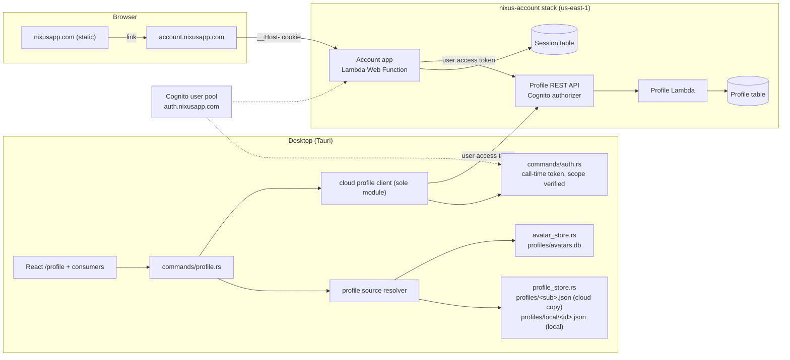
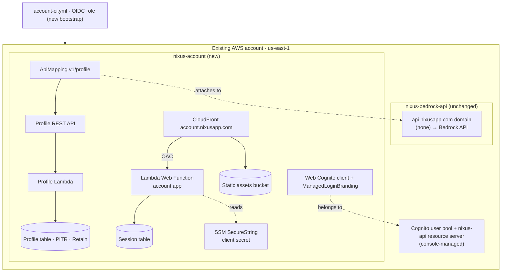
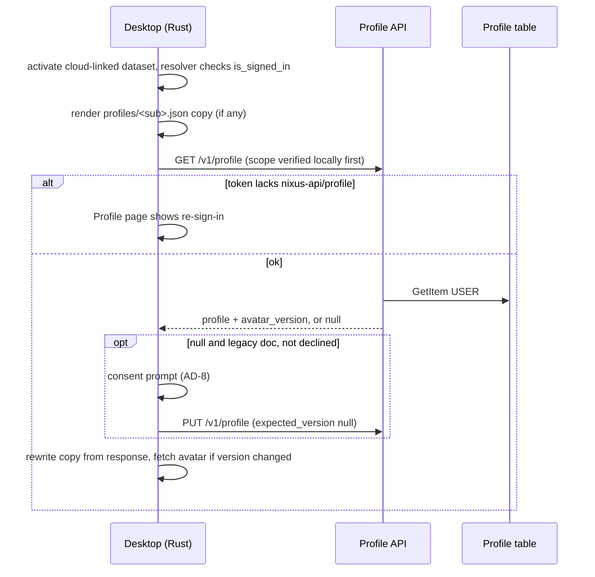

# Architecture Spine — Nixus Cloud Profile & Web Account

**Capabilities governed:** CAP-1 cloud profile service · CAP-2 desktop Nixus Cloud profile · CAP-3 local-profile demographics · CAP-4 first upload of a legacy local profile · CAP-5 web account app · CAP-6 operations & release gates · CAP-7 billing hooks (reserved, not built).

## Design Paradigm

**Cloud-authoritative profile service with read-through device caches, plus a backend-for-frontend (BFF) web account app.**

- **Profile service** (stack `nixus-account`): the only writer and the only validation authority for a Nixus Cloud profile. Every surface is its client.
- **Desktop:** a client that keeps a read-only on-disk copy for instant render and connection loss, and never writes a Nixus Cloud profile locally first. Local profiles (datasets) keep their demographics on the device only.
- **Account app** (`account.nixusapp.com`): a TanStack Start BFF. The browser holds one opaque session cookie; tokens and profile calls stay on the server.
- **Marketing site** (`nixusapp.com`): stays static and only links to the account app.



Dependencies point one way: surfaces → Profile API → profile table. Neither the account app nor the desktop depends on the profile table, and the profile Lambda depends on no surface.

## Inherited Invariants

| Inherited | From | Binds here |
| --- | --- | --- |
| Cognito user pool + stable `sub` is the sole identity authority | `architecture-login.md` | Profile key is `sub`; no second identity system |
| Per-attempt `state` verified on callback, independent of PKCE | `architecture-login.md` | Web sign-in (AD-10) |
| D3 — `sub` resolved in Rust, never accepted over IPC, never in `AuthState` | `architecture-user-profile.md` | Every new desktop profile command |
| D5 — `removeQueries` (not invalidate) for profile keys on identity change | `architecture-user-profile.md` | All profile and avatar query keys |
| D10 — no audit-log rows for profile mutations | `architecture-user-profile.md` | Both homes; restated in AD-12 |
| D11 — no new `invoke()` in always-mounted components | `architecture-user-profile.md` | Launch refresh runs in Rust (AD-7) |
| `select_dataset` / `authorize_selection` refuse a cloud-linked dataset unless `current_subject()` succeeds | code (`commands/datasets.rs`) | AD-7's offline envelope |
| AD-13 — demographic store sits in the global root, not inside a dataset directory | Local Profiles spine | Still true; AD-6 adds a `local/` subfolder in that same root |
| AD-3 — Cognito authorizer + a dedicated resource-server scope; a missing scope is `reauthentication_required`, classified on the desktop | Bedrock spine | Profile API and desktop token path |
| Conventions — structured CloudWatch logs, explicit log groups, 14-day retention, exact IAM action lists | Bedrock spine | AD-14 |
| AD-12 — GitHub OIDC deploys, no long-lived keys, protected `production` env | Bedrock spine | AD-14 |
| AD-15 — `api.nixusapp.com` domain owned by `nixus-bedrock-api` | Bedrock spine | The profile API attaches by mapping only (AD-3) |
| Profile and avatar are files outside the dataset DB and its sync registry | Sync spine *Deferred* | Cloud profile replication is this service, never the sync log |

**Declared departures:**
- AD-13 adds a new `AppError` variant, superseding user-profile D13.
- AD-16 adds an in-app consent prompt, which departs from Bedrock AD-13's "no in-app gate". That rule is scoped to hosted AI.
- AD-6 opens `/profile` to local datasets, superseding user-profile FR4/D1 for local datasets.

## Invariants & Rules

### AD-1 — The cloud is the sole source of truth for a Nixus Cloud profile [ADOPTED]

- **Binds:** CAP-1, CAP-2, CAP-5
- **Prevents:** A local-first write path or merge engine; web and desktop disagreeing; an offline edit overwriting a newer web edit.
- **Rule:** A Nixus Cloud profile changes only through the Profile API's `PUT` routes. Saving requires connectivity on every surface. No device queues, replays or merges profile edits.

### AD-2 — Every Nixus Cloud account has a profile; it is not a premium capability [ADOPTED]

- **Binds:** CAP-1, CAP-5
- **Prevents:** Entitlement checks on profile routes; free accounts locked out of the account page.
- **Rule:** The profile API authorizes on identity and scope only and never reads premium or entitlement state. Users who want no account use local profiles (AD-6).

### AD-3 — Profile API: own stack, shared domain by mapping, identity from the token only

- **Binds:** CAP-1
- **Prevents:** Profile routes inside `nixus-bedrock-api`; a body- or path-supplied `sub`; a second hostname; breaking hosted-AI routing.
- **Rule:**
  - **API and mapping:** a Regional REST API in stack `nixus-account` with a Cognito user-pool authorizer requiring scope `nixus-api/profile`. It is attached to `api.nixusapp.com` by an `AWS::ApiGatewayV2::ApiMapping` with key `v1/profile` and a literal stage name. Longest match wins over the Bedrock catch-all, and the base path is stripped.
  - **Lambda routes:** one Node.js Lambda serves `GET /`, `PUT /`, `GET /avatar`, `PUT /avatar` and `GET /locations`. `/locations` is the cacheable ISO catalog from the Lambda's bundle and still requires the scope.
  - **Identity:** `sub` comes only from the authorizer's verified claims, and must match a UUID shape before any key is composed. `pk`/`sk` never appear in a response.
  - **Domain ownership:** the domain is referenced by name, with no CloudFormation export. `nixus-account` deploys after `nixus-bedrock-api` and never edits the domain or the Bedrock mapping. The domain's routing mode is verified as an API-mapping mode before the first deploy.

### AD-4 — Profile storage shape and optimistic concurrency

- **Binds:** CAP-1, CAP-7
- **Prevents:** Avatar bytes on every read; lost updates; silent overwrite on a missing version; billing data in the profile.
- **Rule:**
  - **Table:** one on-demand DynamoDB table, `pk = USER#<sub>`.
    - `sk = PROFILE` holds the `ProfileFields`, server-owned `version` (integer ≥ 1), `created_at` (set once, never overwritten) and `updated_at`.
    - `sk = AVATAR` holds the derivative as a Binary (`B`) attribute, plus `mime_type`, `version` and `updated_at`.
  - **Versioned writes:**
    - Every `PUT` carries a mandatory `expected_version: number | null`. `null` means create-only and is conditional on `attribute_not_exists(pk)`; a number is conditional on `version = expected_version`.
    - Any failed condition returns `version_conflict` with `resource` and `current_version`, read via `ReturnValuesOnConditionCheckFailure: ALL_OLD`. Never an overwrite.
    - Profile and avatar are never written in one operation.
  - **Reads:** `GET /` returns `null` when absent, otherwise the profile plus `avatar_version: number | null` and no avatar bytes.
  - **Reserved for billing:** sort keys `ENTITLEMENT` and `BILLING_CUSTOMER` are reserved for the billing spine, which decides their writer and how this relates to `HostedAiTable`'s `USER#<sub>/CONFIG`. The profile Lambda's IAM policy is limited to `PROFILE`/`AVATAR` sort keys, and the profile document never carries payment data.

### AD-5 — One validation authority, one copy of the reference data

- **Binds:** CAP-1, CAP-2, CAP-3, CAP-5
- **Prevents:** A surface accepting what the server rejects; two ISO 3166 copies drifting; two avatar contracts.
- **Rule:**
  - **Server validation is final.** The profile Lambda checks:
    - ISO 3166-1/-2 country↔subdivision cross-check;
    - date not in the future, age 18–120;
    - bracket allow-list;
    - currency allow-list, with the asymmetric rule that a bracket without a currency is rejected (`field = income_bracket_currency`) while a currency without a bracket is allowed;
    - 16 KiB profile body ceiling.
  - **Avatar contract** (the same on every surface):
    - Wire shape `{ "mime_type", "data" }` with base64 `data`.
    - `image/png` or `image/jpeg` only, longest edge ≤ 256 px (read from the header), ≤ 64 KiB of decoded bytes, ≤ 96 KiB request body.
    - Each client produces the derivative; the server validates the exact contract. `avatar_store.rs`'s named `CHECK` constraints mirror it.
    - No filename on any route.
  - **Reference data:**
    - The ISO dataset has one canonical file, `packages/shared/data/iso3166.json`. Rust reads it with `include_str!`, the Lambda bundles it, and no frontend ships a copy.
    - Bracket and currency allow-lists are declared once in `account.ts`. A Rust parity test checks `profile_store::VALID_INCOME_BRACKET_CURRENCIES` and the bracket list, and never `db/account::VALID_CURRENCIES`, which is an unrelated allow-list.
  - Desktop and web checks are affordances only. Local documents use the same Rust validator.

### AD-6 — Two homes for demographics, one field set, one resolver

- **Binds:** CAP-2, CAP-3
- **Prevents:** Local demographics leaking to the cloud; filename collisions; reading another account's file; a local profile touching the keyring; orphaned personal data.
- **Rule:**
  - **Storage layout:**
    - `profile_store.rs` owns the demographic documents and the single charset rule.
    - `avatar_store.rs` is the only other accessor of `profiles/`. `danger_zone` calls their functions and never touches files itself.
  - **Nixus Cloud copy:**
    - `profiles/<sub>.json` is a read-only copy with envelope `{ schema_version: 1, cognito_sub, version?, upload_declined?, …ProfileFields }`.
    - `version` and `upload_declined` are `#[serde(default)]` options and `schema_version` stays 1.
    - It is written only from a server response (AD-7), or as AD-8's decline flag.
  - **Local document:**
    - `profiles/local/<dataset-id>.json` is the editable on-device document, with envelope `{ schema_version: 1, dataset_id, …ProfileFields }`.
    - It is never a legal upload body.
    - It is deleted by `delete_dataset_at`, and a launch sweep removes any `local/` document whose id is absent from `datasets.json`.
  - **Resolver:**
    - Returns a source token (`cloud:<sub>` or `local:<dataset-id>`).
    - The local branch never resolves a subject or touches the keyring.
    - The cloud branch requires `commands::datasets::is_signed_in(active, current_subject())`, and otherwise returns "no source".
    - The token is threaded through the operation, is part of the frontend query key, and is re-checked against the active dataset before any write. TFSA room, AI context and the Profile page call the resolver and never choose a file themselves.
  - **Surface:** `/profile` branches on dataset kind first. A local dataset gets an editable form with no session; a cloud-linked dataset gets the session-gated cloud path. The Profile menu entry is visible for local datasets.
  - **Out of scope here:** Migrate-to-Nixus-Cloud copies no demographics (the source local dataset keeps its document), and avatars remain Nixus Cloud-only.

### AD-7 — Desktop read-through copy, save path, and lifecycle

- **Binds:** CAP-2
- **Prevents:** A locally written value the server never accepted; silent scope failure; root-level IPC; avatar re-downloads; the lifecycle drifting between stories.
- **Rule:**
  - **Refresh:**
    - Runs in Rust when a cloud-linked dataset is activated (launch or sign-in), when the Profile page opens, and after each successful save. Never on a timer, and never from an always-mounted component.
    - The avatar is fetched only when `avatar_version` differs from the cached `version` column in `avatars.db`.
    - A network failure keeps the last copy silently. `reauthentication_required` is not silent: the Profile page shows a re-sign-in state.
  - **Save:**
    - `PUT`, then await success, then rewrite the copy from the response.
    - An unobserved response is resolved by `GET` and comparing values before anything is shown to the user.
    - A `version_conflict` reloads that resource and informs the user without asserting that another actor changed it.
    - Offline, the copy is shown with Save disabled. With no copy, the page shows a connect-to-load state.
  - **Lifecycle matrix:**

    | Event | Effect |
    | --- | --- |
    | Sign-out | Copy and avatar cache retained; queries removed |
    | Account switch | Only the new `sub`'s copy is ever resolved |
    | Dataset delete | That dataset's `local/<id>.json` removed |
    | Delete-all (any dataset) | Machine-wide wipe of `<sub>.json` copies and `avatars.db`, plus **only the active dataset's** `local/<id>.json`. The cloud `PROFILE`/`AVATAR` are kept, and the confirmation copy says so. |
    | Migrate | Nothing copied |

  - Existing session and dataset-authorization behaviour is unchanged.

### AD-8 — Consent before first upload of a legacy profile

- **Binds:** CAP-4
- **Prevents:** Date of birth and income leaving the device without consent; quarantining the document being looked for; repeated prompts.
- **Rule:**
  - **Detection:** a legacy document is a `profiles/<sub>.json` with `schema_version == 1` and no `version`. It is detected by a raw, non-mutating probe that never quarantines.
  - **Prompt:** asked once, after a successful `GET` returns `null` (so after any re-sign-in).
  - **Accept:** uploads with `expected_version: null`, and the response replaces the file.
  - **Decline:** sets `upload_declined: true`, and the user is never asked again.
  - **Cloud already has a profile:** the cloud wins and the copy replaces the legacy file.

### AD-9 — One token accessor that verifies scope; one profile network module

- **Binds:** CAP-2
- **Prevents:** A second refresh implementation; a narrowed token breaking hosted AI; network clients in the login/migrate path; tokens sent to arbitrary hosts.
- **Rule:**
  - **Token accessor:**
    - `commands/auth.rs` exposes one call-time access-token accessor: 120 s skew, one refresh-and-retry on `401`. It replaces `hosted_ai_token`/`refresh_hosted_ai_token`; `sync_id_token` stays separate.
    - Its scope argument only **verifies** the granted `scope` claim. Requests always ask for the full `COGNITO_SCOPES` (which adds `nixus-api/profile`), and a stored session is never replaced by one with a narrower scope set.
    - A missing scope means `reauthentication_required`, so pre-upgrade users sign in once more. Hosted AI's closed fallback table is behaviourally unchanged.
  - **Network module:** the profile HTTP client lives in one new module added to the `cloud_link.rs` network-client allowlist.
  - **API URL:** release builds hard-code `https://api.nixusapp.com`. An override exists only under `debug_assertions` and must be `https`.

### AD-10 — Account app is a BFF with server-held, server-checked sessions

- **Binds:** CAP-5
- **Prevents:** Tokens in browser script; login CSRF; session fixation; open redirects; web sign-out killing the desktop session; stale sessions honoured; a leaked client secret.
- **Rule:**
  - **Cognito client:**
    - A confidential client with PKCE, defined in IaC together with an `AWS::Cognito::ManagedLoginBranding` resource. Sole callback `https://account.nixusapp.com/auth/callback`; scopes `openid email profile nixus-api/profile`; same `auth.nixusapp.com` domain as the desktop.
    - Token revocation enabled; access-token TTL 15 min.
    - The client secret is in SSM Parameter Store `SecureString`, read at cold start, never in an env var, template or log.
  - **Sign-in flow:**
    - Each attempt stores a CSPRNG `state`, an OIDC `nonce` and the PKCE verifier in a single-use pre-auth record (10 min) bound to a `__Host-` cookie.
    - The callback rejects a missing or mismatched `state` or `nonce` as non-recoverable.
    - The session id is newly minted at authentication.
    - The post-login destination comes from a server-side allow-list of path constants; no request-supplied URL is ever echoed.
  - **Session:**
    - One opaque cookie (`__Host-`, `Secure`, `HttpOnly`, `SameSite=Lax`).
    - The row is keyed by SHA-256 of the cookie value and carries `idle_expires_at` (24 h) and `absolute_expires_at` (7 d), both checked on every read. The DynamoDB TTL only reclaims storage.
    - Every state change is non-GET and `Origin`-verified, and only an `Origin`-verified request extends the idle expiry.
  - **Sign-out:** deletes the row, calls `/oauth2/revoke` for that refresh token on the web client, and redirects to the Managed Login logout. `GlobalSignOut`/`AdminUserGlobalSignOut` are forbidden. Web and desktop sessions are independent.
  - **Marketing site:** its button is a plain link with a neutral label.

### AD-11 — The account server never touches profile storage

- **Binds:** CAP-1, CAP-5
- **Prevents:** Two writers and two validators of one entity.
- **Rule:** The account server reads and writes profiles only through `https://api.nixusapp.com/v1/profile`, using the user's access token. IAM gives the account-app role nothing on the profile table, and the profile role nothing on the session table. CI guards check both directions.

### AD-12 — No personal data or credentials in logs, errors or audit rows

- **Binds:** all
- **Prevents:** Personal data and tokens accumulating anywhere Nixus operates.
- **Rule:**
  - **Never logged, never in an error message:** profile field values, avatar bytes or base64, tokens, cookies or their hashes, the client secret.
  - **Validation errors:** carry `field` and a stable `reason` enum, never the submitted value. The UI resolves EN/FR text from `code`, `field` and `reason`.
  - **Audit log:** profile mutations in either home write no `audit_log` row (D10). `project-context.md`'s audit rule governs SQLite domain mutations only.
  - **Loggable:** `sub`, route, status, latency, error code, byte sizes.

### AD-13 — Wire contract and error envelope

- **Binds:** CAP-1, CAP-2, CAP-5
- **Prevents:** Per-client shapes; generic error fall-through; two error types for one user action; old clients breaking on new fields.
- **Rule:**
  - **Contract:** `packages/shared/src/types/account.ts` is the canonical snake_case contract for the profile, avatar, locations, allow-lists and the closed error union:
    - `unauthorized`
    - `reauthentication_required`
    - `validation` (+ `field`, `reason`)
    - `version_conflict` (+ `resource`, `current_version`)
    - `payload_too_large`
    - `unsupported_media`
    - `rate_limited`
    - `unavailable`
  - **Gateway responses:** API Gateway `GatewayResponses` for `UNAUTHORIZED`, `ACCESS_DENIED`, `EXPIRED_TOKEN`, `MISSING_AUTHENTICATION_TOKEN`, `THROTTLED`, `REQUEST_TOO_LARGE`, `DEFAULT_4XX` and `DEFAULT_5XX` emit this envelope. An insufficient-scope `403` is reclassified as `reauthentication_required` by the desktop.
  - **Desktop error type:**
    - One new `AppError::CloudProfile { code, message, field?, reason?, recoverable }` for **both** homes, local validation included.
    - `appError.ts` gains one narrowing, read by the avatar message mapper.
    - `reauthentication_required` means the same fact in the `HostedAi`, `Sync` and `CloudProfile` unions.
  - **Evolution:** wire changes are additive only. Clients ignore unknown fields, and an unknown code maps to `unavailable`. Rust mirrors the TS contract, with contract tests on both sides.

### AD-14 — Delivery and operating envelope

- **Binds:** CAP-6
- **Prevents:** Deploying with the Bedrock-scoped role or static keys; losing profile data on a deploy; logs that never expire; unbounded cost; an untested hosting runtime.
- **Rule:**
  - **Environment:** stack `nixus-account` in the existing AWS account, `us-east-1`, one production environment.
  - **Deploy role:** a separately reviewed bootstrap template, applied once by the owner from a workstation (no static keys), creates a GitHub OIDC deploy role with an exact action list scoped to `nixus-account`. It covers Cognito client + branding, the `ApiMapping`, Lambda Web Function, CloudFront, S3, DynamoDB, SSM and logs.
  - **CI:** `.github/workflows/account-ci.yml` verifies on every PR. On `master` it builds `apps/account` then `apps/api-account` and deploys the one stack through the protected `production` environment, so both share one release cadence.
  - **Account app hosting:** CloudFront → **AWS Lambda Web Function** origin through OAC (`lambda:InvokeWebFunctionEndpoint`; unsigned payloads, so no body hash). Static assets come from S3 behind the same distribution. The TanStack Start app is built as a plain Node server.
  - **Data protection:** the profile table has PITR and `Retain` deletion/replace policies. The session table is disposable.
  - **Observability and cost:**
    - CloudFormation-created log groups with 14-day retention.
    - 5xx and throttle alarms.
    - Stage throttle.
    - AWS Budget of $10/month with alerts at 80% and 100%.
    - No WAF in v1.
  - **Runtime:** Node.js 24 for both functions.
  - **Hosting spike:** before account-app stories start, a deploy spike must prove that a 302 redirect, a `__Host-` `Set-Cookie` and a server-function `POST` all work through CloudFront.

### AD-15 — Release gates

- **Binds:** CAP-1, CAP-2, CAP-5, CAP-6
- **Prevents:** Success criteria nothing fails on.
- **Rule:** These block deploy or release:
  - **API and identity**
    - API cross-account test: A's token can neither read nor write B's `PROFILE`/`AVATAR`.
    - Desktop cross-account test: with A's session and a local or B-owned dataset active, no byte of A's profile or avatar is returned.
    - Session-to-`sub` binding test.
    - Scope tests: profile routes reject a token lacking `nixus-api/profile`, and Bedrock routes still reject a token lacking `ai.invoke`.
    - After deploy, `GET https://api.nixusapp.com/v1/ai/status` still reaches the Bedrock API.
    - Pre-deploy assertion that the resource server holds both scopes.
  - **Contract**
    - `account.ts` contract and error-code tests on both sides, including every `GatewayResponse`.
    - The AD-5 allow-list parity test and a no-second-ISO-copy check.
    - A test that no validation response or log line contains a submitted value.
  - **Desktop**
    - A legacy-document survival test: launch → `GET null` → decline leaves the file byte-identical except `upload_declined`, and it is never quarantined.
    - A scope-upgrade test: an `ai.invoke`-only session shows re-sign-in, then the AD-8 prompt after re-sign-in.
    - A token-scope test: after a profile refresh, the stored session still carries `ai.invoke`.
    - A delete-all matrix test matching AD-7.
    - A dataset-delete test and an orphan-sweep test.
  - **Account app**
    - Login-CSRF, fixation, open-redirect (`//host`, `/\host`, absolute, lookalike) and expired-but-present-session tests.
  - **Guards**
    - The AD-11 bidirectional table-reference guards.
    - The AD-9 network-allowlist test and a release-build no-override test.

### AD-16 — Disclosure gates rollout [ADOPTED]

- **Binds:** CAP-4, CAP-5, CAP-6
- **Prevents:** Shipping while copy says profile data never leaves the device; collecting data on the web with no notice.
- **Rule:**
  - **Before rollout:**
    - The README, Privacy Policy and Terms must state where a Nixus Cloud profile (name, date of birth, income bracket, location, picture) is stored, and that local profiles keep demographics on the device.
    - The desktop strings `profile.signInRequiredBody` and `profile.avatar.hint` are rewritten in EN and FR.
    - The delete-all confirmation states that the Nixus Cloud profile is not deleted.
  - **In-app disclosure:** the AD-8 consent prompt, plus a persistent notice on the web profile form that the profile is stored in the user's Nixus Cloud account. In-app copy names no provider or region.
  - **Amendment 2026-11-18 (owner decision):** the web profile form carries no storage notice. Users reach it only by signing in to their Nixus Cloud account, and the Privacy Policy states where the profile is stored. The desktop consent prompt (AD-8) is unchanged.
  - **Brand term:** "Nixus Cloud" stays untranslated in French on every surface (user-profile NFR8).
  - **Supersedes:** user-profile NFR2, FR8 and NFR4 for Nixus Cloud profiles.

### AD-17 — Entitlement principle for the billing spine [ADOPTED]

- **Binds:** CAP-7
- **Prevents:** An unpaid user obtaining a premium capability; trusting an editable on-disk flag.
- **Rule:**
  - Cloud-run premium features are gated on the server.
  - A premium feature that runs on the device gates only on a server-signed, `sub`-bound, expiring entitlement statement, verified offline with an embedded public key. An unsigned on-disk premium flag is never trusted, and last-known status may be displayed but never authorizes.
  - **Current exception:** sync's `MULTI_DEVICE_SYNC` gate is client-side today. Moving it server-side, the signed statement, and replacing the manual premium `put-item` all belong to the billing spine.
  - No new premium capability may ship with a client-side gate.

## Consistency Conventions

| Concern | Convention |
| --- | --- |
| Naming | Stack `nixus-account`; scope `nixus-api/profile`; routes under `/v1/profile`; DynamoDB `pk=USER#<sub>`, `sk ∈ {PROFILE, AVATAR}` (reserved `ENTITLEMENT`, `BILLING_CUSTOMER`); contract `account.ts`; desktop error `AppError::CloudProfile`; source token `cloud:<sub>` / `local:<dataset-id>` |
| Data & formats | snake_case JSON on every wire and file; dates `YYYY-MM-DD`; absent = `null`, never `""`; `version` positive integer; ISO 4217 uppercase currency; ISO 3166-1 alpha-2 country, ISO 3166-2 subdivision |
| State & cross-cutting | Writes go through the API (AD-1/AD-11); device writes the cloud copy only from a server response; `sub` from verified tokens only; profile-family query keys share the `profile` prefix and are removed on identity change (the `auth:callback-received` sweep removes the prefix, not a hand list); logs per AD-12 |
| i18n | Account app follows `apps/web`'s `src/locales/{en,fr}.json` + `/fr/*` routes with a copied parity test; bracket, currency and error **codes** come from `account.ts`, display strings are per app |

## Stack

| Name | Version |
| --- | --- |
| Node.js (profile Lambda, account Web Function) | 24.x, ARM64 |
| TypeScript | ~5.8.3 |
| AWS SAM (IaC for `nixus-account`) | existing toolchain |
| `@aws-sdk/client-dynamodb` / `lib-dynamodb` | ^3.1118.0 (latest 3.1170.0, verified 2026-11-17) |
| `@tanstack/react-start` (account app) | ~1.167.65 (≥1.169 requires Vite 8; repo is on Vite 7.3.2) |
| Vite | ^7.0.4 (workspace) |
| Vitest | ^3.2.4 |
| API Gateway | Regional REST API, TLS 1.2, `ApiGatewayV2::ApiMapping` key `v1/profile` |
| Lambda Web Functions | current AWS service (Node runtimes only), CloudFront OAC origin |
| DynamoDB | on-demand; profile table PITR + Retain; session table TTL |

## Structural Seed

```text
apps/
  api-account/            # owns stack nixus-account: template.yaml, profile Lambda (src/functions/api.ts → handlers/)
  account/                # TanStack Start BFF for account.nixusapp.com (Node server build → Lambda Web Function)
  desktop/src-tauri/src/
    profile_store.rs      # cloud-copy envelope, profiles/local/<id>.json, raw legacy probe
    avatar_store.rs       # + version column
    <cloud profile client># sole profile network module (AD-9)
    commands/profile.rs   # resolver + refresh/save orchestration
packages/shared/
  data/iso3166.json       # canonical ISO dataset (AD-5)
  src/types/account.ts    # wire contract, allow-lists, error codes
infra/bootstrap/          # + reviewed OIDC bootstrap for nixus-account
.github/workflows/account-ci.yml
```





## Capability → Architecture Map

| Capability | Lives in | Governed by |
| --- | --- | --- |
| CAP-1 cloud profile service | `apps/api-account`, profile table | AD-1–AD-5, AD-11, AD-13 |
| CAP-2 desktop Nixus Cloud profile | `profile_store.rs`, `avatar_store.rs`, profile client, `commands/profile.rs`, `hooks/useProfile.ts` | AD-1, AD-6, AD-7, AD-9, AD-13 |
| CAP-3 local-profile demographics | `profile_store.rs` (`local/`), resolver, `/profile` | AD-5, AD-6, AD-7 |
| CAP-4 legacy first upload | `profile_store.rs` probe, `commands/profile.rs`, Profile page | AD-8, AD-16 |
| CAP-5 web account app | `apps/account`, session table, web Cognito client | AD-2, AD-10, AD-11, AD-13, AD-16 |
| CAP-6 operations & gates | `nixus-account` stack, bootstrap, `account-ci.yml` | AD-12, AD-14, AD-15, AD-16 |
| CAP-7 billing hooks | reserved sort keys, account server | AD-4, AD-17 |

## Deferred

- **Billing and payments** (own spine). Provider leaning: Stripe Managed Payments as merchant of record (LemonSqueezy closes 2027-03-31; check product-category eligibility). Also deferred there:
  - checkout and customer portal on the account server;
  - webhook ingestion and the writer for `ENTITLEMENT`;
  - one entitlement home versus `HostedAiTable`;
  - the AD-17 signed statement;
  - server-side sync gating;
  - replacing the manual premium runbook;
  - the per-partition write ceiling on `USER#<sub>`.
- **Mobile purchases** (in-app purchase via RevenueCat keyed on `sub`, or link-out). Store rules are regional and in litigation.
- **Nixus Cloud account deletion and the privacy-law erasure path.** Out of scope; still a pre-launch legal item.
- **WAF:** regional web ACL (~$8/month) or the CloudFront flat-rate plan with bundled WAF, if abuse appears. The stage throttle is API-wide, so one abusive `sub` can degrade others; accepted for v1.
- **Purging the cloud copy on sign-out.** Revisit when the copy becomes the only on-device personal data for several accounts on a shared machine.
- **Moving Cognito under IaC.** When the pool and resource server move to IaC, import the resource server with both scopes in one template; never patch it.
- **Avatars for local profiles; Google federation; a staging environment; moving `sync-infra.yml`/`web-ci.yml` off static keys; signed-in state on the marketing site; API Gateway routing rules** (AWS now prefers routing rules over API mappings for REST APIs).
- **Source-document supersession notes** (to land with the first implementation commit):
  - `architecture-entitlements-licensing.md`: provider and entitlement authority;
  - `architecture-user-profile.md`: NFR2, NFR4, FR8, FR4/D1 for local datasets, D13;
  - the sync spine's deferred profile/avatar item;
  - `architecture-web.md`'s planned `/account`, `/login` routes, which move to `account.nixusapp.com`.
