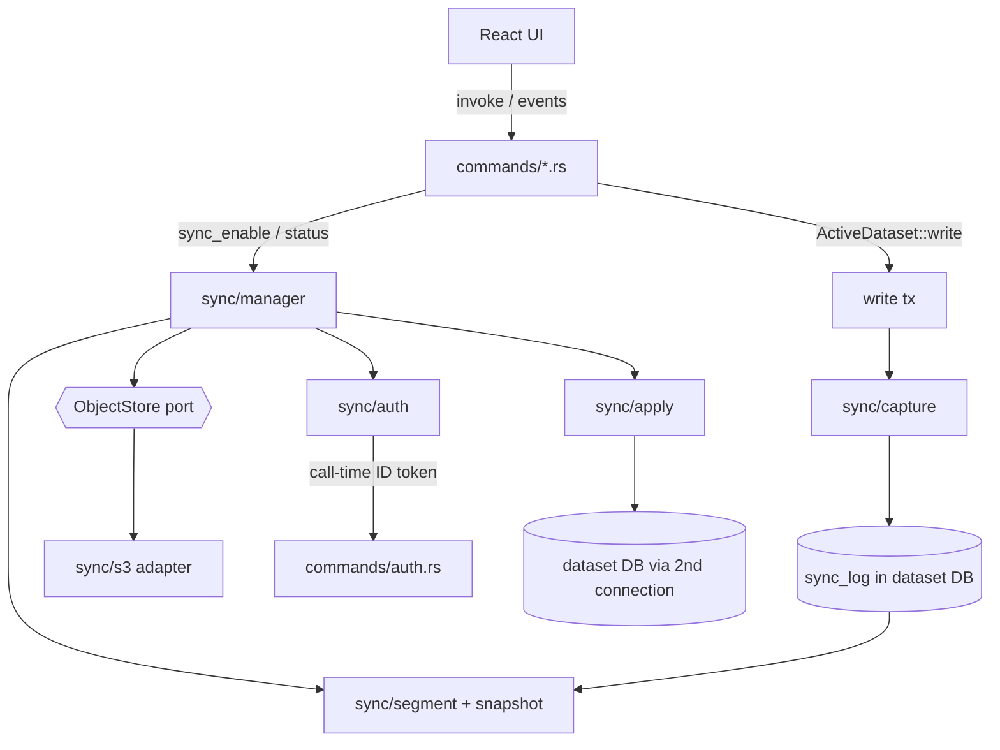
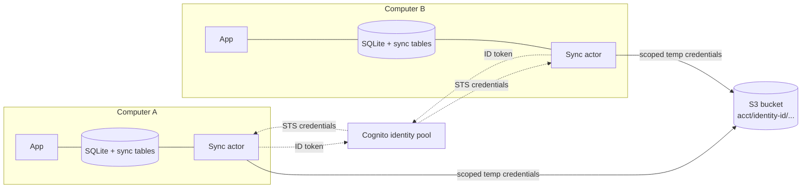
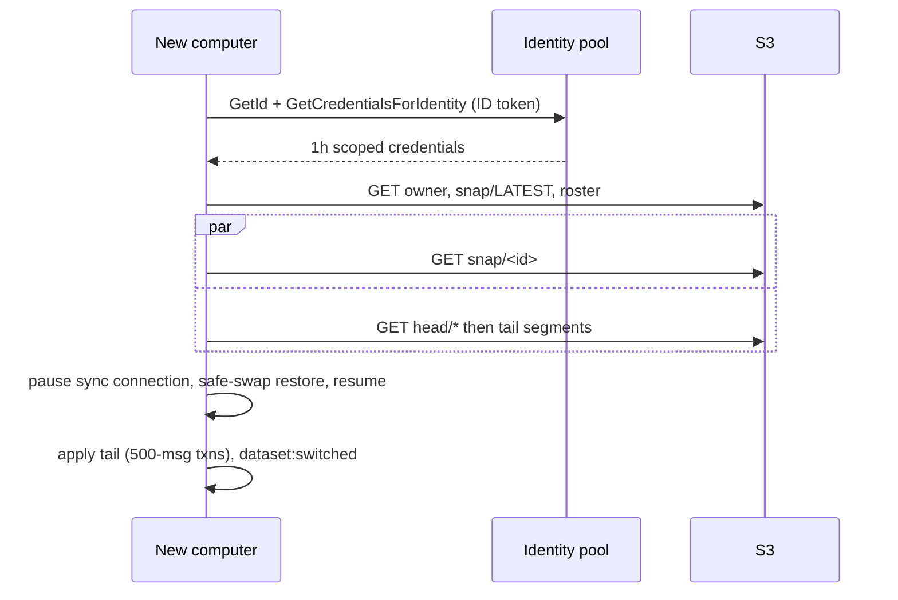

# Architecture Spine — Nixus Cloud Multi-Device Sync

## Design Paradigm

**Local-first replicated log, materialized view.** The dataset's SQLite tables remain the only thing the UI reads and writes (the *view*). Every change is also recorded as an immutable, clock-stamped message in `sync_log` (the *replication record*). Computers exchange messages through private object storage and fold remote messages into their own view with the same apply semantics as local edits. Transport is a port; the S3 client is an adapter, mirroring the existing `ai/backend.rs` port pattern.

```text
apps/desktop/src-tauri/src/sync/
  mod.rs        # public surface: SyncManager handle, SyncStatus
  manager.rs    # actor: owns the 2nd connection, clock, schedule, status, pause/close for file swaps
  capture.rs    # pre-update hook, buffer, flush, balance emitters, reconcile
  registry.rs   # table/column classification: Synced | LocalOnly; merge kind; FK policy table
  clock.rs      # HLC + install id
  apply.rs      # fold messages into the view (the single apply path), quarantine
  segment.rs    # message batches <-> zstd bytes + header
  snapshot.rs   # build / restore snapshots, applied vector
  store.rs      # ObjectStore port (trait)
  s3.rs         # S3 adapter (only file that names aws-sdk-s3)
  auth.rs       # identity-pool credentials from a call-time ID token
```

## Inherited Invariants

| Inherited | From parent | Binds here |
| --- | --- | --- |
| AD-1 One dataset = one directory + one SQLite file; `db/` never becomes dataset-aware internally | Local Profiles & Nixus Cloud | Sync state lives in the dataset's own DB so backup, restore and copy carry it; `MIGRATIONS` and `db/backup.rs` gain no dataset logic |
| AD-6 `DbState = Mutex<ActiveDataset { id, conn }>`; hot-swap emits `dataset:switched`; lock order registry → active | Local Profiles & Nixus Cloud | Sync follows the active dataset and stops on `dataset:switched`; introduces no new lock ahead of these; its second connection is the one stated exception (AD-11) |
| AD-8 Per-dataset keyring entries | Local Profiles & Nixus Cloud | No sync secret is ever stored in the keyring |
| AD-12 Cloud-linked dataset keyed by Cognito `sub` | Local Profiles & Nixus Cloud | Only `kind: cloud-linked` datasets are eligible to sync |
| AD-10 `credentials.rs` sole keyring accessor; call-time token from `commands/auth.rs`, 120 s skew | Nixus Cloud Bedrock | `sync/auth.rs` obtains the ID token only from `commands/auth.rs` |
| AD-11 Content statelessness covers Nixus-controlled AI request content only | Nixus Cloud Bedrock | Not extended to sync: the synced ledger is deliberately persisted; copy must not imply otherwise |
| AD-12 GitHub OIDC deploy, no long-lived AWS keys | Nixus Cloud Bedrock | **Scoped deviation (owner decision, 2026-10-13):** the sync stack deploys from its own workflow using the repository's existing AWS credentials (the `AWS_ACCESS_KEY_ID` / `AWS_SECRET_ACCESS_KEY` repository secrets) instead of OIDC. The Bedrock pipeline is unchanged; moving sync to OIDC later is a drop-in change |
| AD-13 Disclosure via Terms/Privacy, no in-app consent gate | Nixus Cloud Bedrock | Sync copy changes ship in README/Privacy/Terms before rollout; enabling sync stays an explicit opt-in action |
| AD-15 One production stack, no staging in v1 | Nixus Cloud Bedrock | The sync stack is separate (AD-17) and single-environment |
| AD-1 "Server-side brokering only; no AWS credential on a device" | Nixus Cloud Bedrock | **Scoped amendment for sync only:** sync vends 1-hour, prefix-scoped S3 credentials held in memory (AD-7). The hosted-AI path is unchanged: `ai/hosted_bedrock.rs` still never builds an AWS client, and sync credentials are unreachable from `ai/` |

## Invariants & Rules



Dependencies point down the diagram only. `sync/` may use `db/`, `models/`, `error.rs`, and the token accessor in `commands/auth.rs`. `db/` and `commands/*` (except `commands/sync.rs`) reach `sync/` only through `ActiveDataset::write` and the two balance emitters (AD-5).

### AD-1 — One apply path; the log is replication truth, the tables are the view

- **Binds:** CAP-3, CAP-4
- **Prevents:** Remote changes taking a different code path than local ones and diverging in constraints, defaults or derived values; the UI reading anything but the local tables.
- **Rule:** Remote messages are folded into the tables only by `sync::apply`. The UI and every `commands/*` read only the local tables. `sync::apply` never calls into `commands/`.

### AD-2 — Row identity lives in a side table, not in the data tables

- **Binds:** CAP-4
- **Prevents:** Two computers minting the same integer id for different rows; migrating 20+ tables (and local-only users paying for it); duplicate rows from independent creation of the same natural-key row; a natural key built from machine-local integers.
- **Rule:** `sync_uuid(table, row_id, uuid BLOB(16))` maps each synced row to a 16-byte random uuid, created by `sync/capture` the first time it sees the row; integer ids and FKs in data tables are unchanged and local-only. Messages reference rows and parents only by uuid. A row's mapping is removed when its tombstone is recorded, so rowid reuse (`INTEGER PRIMARY KEY` without `AUTOINCREMENT`) cannot alias identities. Rows with a schema-level natural key derive their uuid as UUIDv5 over that key **expressed in uuids of the rows it references, never local integers**: `merchant_category_hints (merchant, category uuid)`, `maintenance_tasks (vehicle uuid, task_type_key)`; `project_images` takes its owning project's uuid. Rows that every computer generates on its own from a template (recurring expenses and recurring income applied at startup) take UUIDv5 over `(template uuid, period)`, so two computers generating the same month's row create one row, not two. Natural-key and generated rows are mapped explicitly at their insert sites.

### AD-3 — Capture: pre-update hook, flushed inside the write transaction, reconciled when it cannot be

- **Binds:** CAP-3, CAP-4
- **Prevents:** Changes that never reach `sync_log` (silent divergence); log entries for rolled-back transactions; hand-instrumenting ~230 SQL statements; a volatile "dirty" flag being the only safety net.
- **Rule:** On the UI write connection of a sync-enabled dataset, `sync/capture` registers a pre-update hook that only appends to an in-memory buffer; cascade children (query depth ≥ 1) are captured as ordinary changes. `ActiveDataset::write(|tx| …)` (new; it does not exist today) runs the closure, flushes the buffer into `sync_log` in the **same transaction**, then commits; rollback discards the buffer. Writes made outside `write` are healed by **reconcile**, which runs at every startup and when idle for as long as any unmigrated write site exists: it compares live column values with `sync_field_state.content_hash`, emits the missing messages (`balance_set` for a changed balance), and treats the tables as truth. A checked-in budget file lists unmigrated write sites and CI fails if the count grows. Committed regression tests pin that the hook sees `INSERT OR REPLACE`, `DELETE` without `WHERE` (SQLite skips its truncate shortcut while a pre-update callback is registered), cascades, and `WITHOUT ROWID` tables.

### AD-4 — Hybrid logical clock with bounded drift

- **Binds:** CAP-4
- **Prevents:** Two computers ordering the same events differently; a skewed clock winning every conflict.
- **Rule:** One HLC (`uhlc`, configured with a 5-minute maximum delta) per install; the install id is 8 random bytes created once and stored in `sync_state` together with an OS machine fingerprint. Every message carries `(hlc, install)`; its identity is `(install, seq, idx)`. Remote timestamps more than 5 minutes ahead are rejected and surface `clock_skew`; ties break by install id. If the stored fingerprint differs from the current machine (a copied database), the install id is regenerated and the dataset relinks (AD-9).

### AD-5 — Merge kinds are declared per column; balances are set-plus-delta

- **Binds:** CAP-4
- **Prevents:** Last-write-wins silently losing concurrent money movements; two computers double-counting one real-world action; a new table or column syncing by accident; a local-only table leaking to the cloud.
- **Rule:** `sync/registry.rs` classifies every table `Synced` or `LocalOnly` and every synced column `Lww` (default), `Counter` or `Balance`; a test fails on any unclassified table in the migrations. Everything the user can see or has done syncs: `audit_log` is `AppendOnly` (the action log is shared, its rows carry the origin computer's entries, and remote-applied changes write no new audit row) with a nullable `entity_uuid` column so entries survive differing integer ids; `config` is `Synced` except a deny list of keys that describe this computer's credential state (`ai_configured`, `ai_provider`, `aws_region`). `LocalOnly`: `schema_version` and all `sync_*` tables only. AI credentials live in the keyring and never sync. Stored in `sync_field_state`, a field applies only if its message `hlc` is greater than the stored one, whatever the arrival order. **Counter** (`merchant_category_hints.usage_count`, which is only ever incremented) is captured by the hook as a signed delta `new − old` and its value is the sum of deltas, de-duplicated by message id. **Balance** (`accounts.balance_cents`) is never captured by the generic hook; it is written only through two emitters in `db/account.rs`: `adjust_account_balance` emits a **delta** keyed by its cause `(cause row uuid, kind)` — so two computers deleting the same expense produce one delta — and `update_account_balance` and account creation emit a **`balance_set`**. The value is the latest `balance_set` by `hlc` plus the sum of deltas with a later `hlc`. Replicas add an emitted delta verbatim and never recompute it with `balance_delta_cents`. A delete is a tombstone message carrying the full row; **delete wins** over concurrent edits (AD-12 for the restricted edge); tombstoned rows are restorable for 30 days from `sync_tombstone`.

### AD-6 — Immutable objects, a roster, and two single-purpose mutable keys

- **Binds:** CAP-1, CAP-2, CAP-4, CAP-9
- **Prevents:** Two computers overwriting each other's data; a new computer that no one else can discover; billed LIST polling; a coordinator server; treating every conditional-write error as "already exists".
- **Rule:** All keys live under `acct/<identity-id>/`. Immutable objects (`log/<install>/<seq>`, `snap/<snap-id>`, `blob/<sha256>`) are written with `If-None-Match: *` and carry their content hash as object metadata. Outcomes: `200` done; `412` the key exists — success only if the stored hash matches, otherwise it is an install-id collision (regenerate and relink); `409` a concurrent writer — retry; `404` under `If-Match` — re-read. Mutable keys: `head/<install>` (one writer), `snap/LATEST` and `roster` (both `If-Match` compare-and-swap, re-read and retry on failure). `roster` lists install ids; an install adds itself on first sync, and everyone polls `roster` plus each known `head/<install>` with conditional GETs (a `304` is still billed as a GET). LIST is a repair path only.

### AD-7 — Identity-pool credentials scoped to the account prefix; identity is pinned

- **Binds:** CAP-9
- **Prevents:** One account reading another's data; long-lived AWS credentials on a device; a request path through a server; a computer silently starting a second source of truth under a different identity id.
- **Rule:** The app presents the existing user-pool ID token to a Cognito **identity pool in the enhanced flow** (`GetId`, `GetCredentialsForIdentity`; basic flow disabled). The authenticated role allows S3 only on `acct/${cognito-identity.amazonaws.com:sub}/*` (`s3:ListBucket` conditioned on that `s3:prefix`); its trust policy pins `:aud` to the pool and `:amr` to `authenticated`. Temporary credentials (1 h) live only in memory and refresh before expiry. The identity id is stored in `sync_state`, and `acct/<id>/owner` (created `If-None-Match: *`) holds the user-pool `sub`; a later `GetId` that returns a different id, or an `owner` that differs from the signed-in `sub`, refuses to sync and reports `error`. The cross-account denial test is a release gate (AD-19).

### AD-8 — Server-side encryption by S3 default only; format reserves a scheme byte

- **Binds:** CAP-9
- **Prevents:** Plaintext over the wire or an open bucket; a future client-side-encryption tier requiring a format break.
- **Rule:** The bucket uses S3 default encryption (SSE-S3), block-public-access, and a policy denying non-TLS requests. Every segment, snapshot and blob starts with a header (magic, format version, `enc_scheme`, `schema_version`, content hash); `enc_scheme` `0` means none and readers reject unknown schemes. No client-side encryption in v1.

### AD-9 — Bootstrap is snapshot-first; every file swap is guarded; a restore never rewinds the cloud

- **Binds:** CAP-1, CAP-2, CAP-5
- **Prevents:** A new computer replaying unbounded history; a snapshot claiming segments it does not contain; local-only data leaking into the cloud; a second connection corrupting a database that is being replaced; a restored old backup silently overwriting newer cloud data.
- **Rule:** A snapshot is built with the **SQLite online backup API** (rowids are preserved; `VACUUM INTO` may renumber), then, in the copy and on a connection without the hook, `LocalOnly` tables, `sync_log` and `project_images` bytes are emptied and thumbnails kept. Its watermark is the copy's own `sync_applied_vector`, never read separately. A new computer reads `snap/LATEST`, downloads the snapshot and the tail after its vector (in parallel), and restores through `db/backup.rs`'s sequence — checkpoint, safety copy, in-place copy over the live file, sidecars removed, reopen, rollback on failure (it is not an atomic rename) — with `LocalOnly` tables carried over from the safety copy and unsent `sync_log` rows re-applied after. A new snapshot is written when the tail exceeds 2 MB or 5,000 messages. Before **any** file swap (bootstrap, restore, backup import, dataset copy) the manager closes its connection and resumes afterwards. A restore or clone clears the sync tables and relinks the dataset through the CAP-5 choice (*replace* with a dated backup, or *separate*); the first computer to enable sync uploads the initial snapshot.

### AD-10 — Images are content-addressed and lazy

- **Binds:** CAP-6
- **Prevents:** Multi-megabyte images in the first load; duplicate uploads; a schema that cannot represent a not-yet-fetched image.
- **Rule:** A migration rebuilds `project_images` with `image_bytes` nullable, an `image_sha256` column, and the byte-size CHECK relaxed to allow absent bytes (a one-time rewrite of stored blobs). Full images are `blob/<sha256>`, uploaded `If-None-Match: *` and fetched on first view with a placeholder. Image bytes are excluded from segments, snapshots and reconcile hashing; `image_sha256` and thumbnails sync normally.

### AD-11 — Remote apply runs on a second connection, in small, isolated transactions

- **Binds:** CAP-3, CAP-4, CAP-7
- **Prevents:** Remote apply freezing the UI; one bad message wedging every later batch; out-of-order messages breaking foreign keys; dropping what a computer does not understand yet.
- **Rule:** The sync actor opens **one extra connection** to the active dataset file (WAL, busy timeout, `foreign_keys=ON`, capture hook off) and applies in `BEGIN IMMEDIATE` transactions of at most 500 messages or about 20 ms, yielding between them. `defer_foreign_keys` is re-issued inside every transaction because SQLite resets it at commit. Per install, segments apply in contiguous `seq` order and advance `sync_applied_vector` in the same transaction as the data. If a batch fails to commit, it is replayed message by message in savepoints: a message with a missing parent or subject row goes to `sync_pending`; a UNIQUE, CHECK or NOT NULL violation, or any other failure, goes to `sync_quarantine` with a reason and never blocks later messages; a message naming an unknown table, column or newer `schema_version` is parked until the app updates. This is the single exception to one connection per dataset (Local Profiles AD-6); it closes on `dataset:switched`.

### AD-12 — Per-edge foreign-key merge policy

- **Binds:** CAP-4
- **Prevents:** Different computers resolving a parent delete versus a concurrent child change differently; cascaded children vanishing without a trace.
- **Rule:** A delete message carries the full row, so cascaded children (captured as their own tombstones at depth ≥ 1) are restorable. Applying a parent tombstone lets FK `CASCADE` run locally with the hook off; a child message for a tombstoned parent is dropped, and a balance delta addressed to a tombstoned row is added to the row retained in `sync_tombstone`. The one `RESTRICT` edge (`project_contributions.account_id → accounts`): a live child wins and the account tombstone is overridden. The four `SET NULL` edges replay as ordinary field writes. Every FK edge appears in a policy table in `registry.rs`; a test fails on an unclassified edge.

### AD-13 — Retention without a computer registry

- **Binds:** CAP-2, CAP-8
- **Prevents:** Unbounded growth; deleting segments a current snapshot still needs; cleanup that depends on a user-visible device list.
- **Rule:** A computer that has just written a snapshot may delete segments older than 90 days **only up to the watermark of whatever `snap/LATEST` points to when re-read at deletion time**, keeps the two newest snapshots, and removes install ids unseen for 90 days from `roster`. A computer offline longer than that re-bootstraps from the latest snapshot and re-applies its own unsent `sync_log` (carried across the swap, AD-9). Nothing is deleted for a `Frozen` account. Orphaned blob cleanup is deferred.

### AD-14 — Entitlement is one capability flag

- **Binds:** CAP-1, CAP-8
- **Prevents:** Tier names hard-coded in sync code; sync running after a downgrade.
- **Rule:** The manager checks the entitlement capability `multi_device_sync` before every network operation. When it is absent the state is `Frozen`: no uploads or downloads, the cloud copy is untouched, the local app runs normally. Restoring from the frozen cloud copy on demand is not offered in v1 (support-assisted only); regaining the flag resumes sync.

### AD-15 — Sync state lives in the dataset DB; wipe unlinks

- **Binds:** CAP-1, CAP-5
- **Prevents:** Two copies of one database appending the same `(install, seq)`; a wipe emitting thousands of tombstones or erasing other computers' data; state living outside the file that backup and restore carry.
- **Rule:** The tables `sync_state`, `sync_uuid`, `sync_log`, `sync_field_state(table, row_uuid, column, hlc, install, content_hash)`, `sync_applied_vector(install, seq, offset)`, `sync_tombstone(table, row_uuid, hlc, row_json, purge_after)`, `sync_pending` and `sync_quarantine` are in the dataset DB, are `LocalOnly`, and appear in `WIPE_TABLES`. Writers: capture writes `sync_log`, `sync_uuid`, `sync_tombstone` and `sync_field_state` for local changes; apply writes the tables plus `sync_field_state`, `sync_applied_vector`, `sync_tombstone`, `sync_pending`, `sync_quarantine`; the manager writes `sync_state` and `head`; reconcile writes through capture. `danger_zone` wipe of a synced dataset detaches the hook, deletes locally, clears the sync tables and sets the state `Unlinked`; it never touches the cloud or other computers. There is no epoch-reset message.

### AD-16 — Sync never blocks; status and diagnostics are events and counts

- **Binds:** CAP-1, CAP-3, CAP-7
- **Prevents:** Network or AWS faults degrading launch or the UI; sync errors reaching users as generic failures; support needing user content to debug.
- **Rule:** The manager is a Tokio actor; the UI only invokes `sync_enable`, `sync_status`, `sync_now` and `sync_diagnostics`, and listens to a `sync:status` event with states `idle | syncing | offline | update_needed | frozen | unlinked | error`. Faults use a new `AppError::Sync { code, message, recoverable }`, narrowed on the frontend like `HostedAi` (a stated, deliberate exception to Local Profiles' "no new variant" convention). `sync_diagnostics` exports only counts, states, timings, HLC ranges and error codes, never values; log lines never contain row values.

### AD-17 — Infrastructure is a separate, compute-free stack

- **Binds:** CAP-9
- **Prevents:** Coupling sync to the hosted-AI stack's lifecycle; any always-on resource; a deploy path that bypasses review.
- **Rule:** `infra/sync/template.yaml` (stack `nixus-sync`) defines the bucket (versioning on, noncurrent versions expire after 30 days, abort-incomplete-multipart after 7 days, `DeletionPolicy: Retain`), the identity pool, and the authenticated role only. The stack, the bucket and the identity pool are all in **us-east-1**, the region of `nixus-bedrock-api` and the user pool. It deploys from its own GitHub Actions workflow (`master` only, `production` environment) using the repository's existing AWS credentials; no new IAM deploy role or bootstrap change is required, and the Bedrock deploy and execution roles are untouched.

### AD-18 — Cost and abuse are watched and bounded client-side

- **Binds:** CAP-9
- **Prevents:** A buggy or modified client writing unbounded data with no server to stop it; cost drift going unnoticed.
- **Rule:** The client enforces maximum segment, snapshot and blob sizes and a maximum object rate. The stack enables S3 request metrics with an alarm, and an AWS Budget scoped to S3 with alerts at 80% and 100%, notifying the existing alert topic pattern. Neither stops traffic.

### AD-19 — Verification gates

- **Binds:** CAP-2, CAP-3, CAP-4, CAP-9
- **Prevents:** Success criteria that nothing fails the build on.
- **Rule:** These fail CI or block release: the cross-account denial test (AD-7); the N-replica randomized convergence simulator including duplicated, dropped and reordered segments, concurrent delete/edit and double-delete (AD-4, AD-5, AD-11, AD-12); the new-computer timing test against a heavy-year dataset (CAP-2); the capture regression tests and write-site ratchet (AD-3); a local-write latency gate against the recorded baseline (CAP-3); and the classification tests (AD-5, AD-12).

## Consistency Conventions

| Concern | Convention |
| --- | --- |
| Naming | Rust modules `snake_case` under `sync/`; commands `sync_*`; event `sync:status`; tables `sync_*` |
| Data & formats | uuid is `BLOB(16)`; money is `i64` cents; message id is `(install, seq, idx)`; clock is HLC `(wall_ms, counter, install)`; object bytes are `header + zstd(payload)`; the payload encoding is one pinned binary format chosen in the first story and frozen with the format version |
| State & cross-cutting | Writers per table as listed in AD-15; no AWS credential is ever persisted; no log line contains values |

## Stack

| Name | Version |
| --- | --- |
| Rust toolchain | 1.94.1 or newer (AWS SDK crate MSRV; machine currently 1.94.0) |
| tauri | 2.11 (existing; 2.12.3 is current) |
| rusqlite | 0.40 (from 0.38; features `bundled`, `preupdate_hook`, `hooks`, `backup`) |
| libsqlite3-sys | 0.38.2 (via rusqlite; `preupdate_hook` forces `buildtime_bindgen`: bindgen and libclang are required on every build machine and CI runner) |
| aws-sdk-s3 | 1.152.0 |
| aws-sdk-cognitoidentity | 1.116.0 |
| aws-config | 1.8 (existing) |
| uhlc | 0.9.0 |
| uuid | 1.28.0 (feature `v5`) |
| zstd | 0.14.2 |
| tokio | 1.50 (existing) |
| proptest | 1 (dev) |
| AWS SAM | existing toolchain; new stack `nixus-sync` |

## Structural Seed





```text
S3 bucket (SSE-S3, TLS-only, block public access, versioning on)
acct/<identity-id>/
  owner                     create-only: user-pool sub
  roster                    mutable, If-Match: install ids
  head/<install>            mutable, single writer
  log/<install>/<seq>       immutable segment
  snap/<snap-id>            immutable snapshot
  snap/LATEST               mutable, If-Match
  blob/<sha256>             immutable image
```

Deployment: stack `nixus-sync` holds the bucket, the identity pool and the authenticated role; no compute; deployed by its own CI workflow with the repository's existing AWS credentials; single production environment; region pending (Deferred).

## Capability → Architecture Map

| Capability / Area | Lives in | Governed by |
| --- | --- | --- |
| CAP-1 enable, source of truth | `sync/manager`, `commands/sync.rs` | AD-9, AD-14, AD-15, AD-16 |
| CAP-2 new-computer speed | `sync/snapshot`, `sync/s3` | AD-6, AD-9, AD-10, AD-19 |
| CAP-3 local-first, offline | `ActiveDataset::write`, `sync/capture` | AD-1, AD-3, AD-11, AD-16, AD-19 |
| CAP-4 convergence | `sync/registry`, `sync/apply`, `sync/clock` | AD-2, AD-4, AD-5, AD-11, AD-12, AD-19 |
| CAP-5 link choice | `commands/sync.rs`, `db/backup.rs` | AD-9, AD-15 |
| CAP-6 lazy images | `sync/snapshot`, blob path, `project_images` migration | AD-10 |
| CAP-7 version skew | `sync/apply`, `sync/segment` header | AD-8, AD-11, AD-16 |
| CAP-8 downgrade freeze | `sync/manager` | AD-13, AD-14 |
| CAP-9 isolation, cost | `infra/sync`, `sync/auth` | AD-7, AD-8, AD-17, AD-18, AD-19 |

## Deferred

- **Accumulating-column audit is done.** Savings-project totals are `SUM` over contributions (derived, nothing to merge); net-worth totals are per-date snapshot rows; odometer is a plain value (service logs only raise it; a direct set is the user's latest action, so last-write-wins); `usage_count` is a `Counter`; `balance_cents` is a `Balance`. The residual risk is `net_worth_snapshots.breakdown_json`, last-write-wins as a whole document with no per-date uniqueness; accept or redesign.
- **Data outside the dataset DB is not covered.** The demographic Profile (`profiles/<sub>.json`: province, income bracket, TFSA tracking) and avatars (`profiles/avatars.db`) live beside the datasets (Local Profiles AD-13), so they do not sync under this design. Syncing them needs a separate decision and mechanism.
- **Binary payload encoding and compression level** — chosen in the first implementation story, then frozen with the format version.
- **Retention (90 days), snapshot thresholds (2 MB / 5,000 messages), poll interval, segment cadence** — tune from beta data against the cost ceiling.
- **Orphaned blob cleanup.**
- **Client-side encryption tier, merging divergent datasets, push channel, LAN sync, mobile** — non-goals; the header scheme byte and the transport port keep them open.
- **Support-handled erasure path** for privacy law — product and legal.
- **UX of the status indicator, the link choice, and the "changed on another device" cue** — a UX pass.
